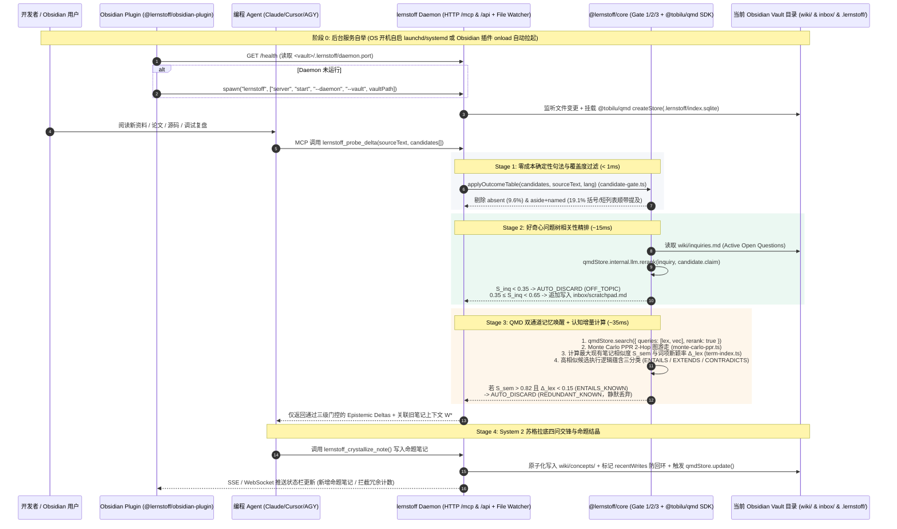

# `lernstoff-wiki` 产品与技术架构需求文档 (PRD v2.0)

> **项目代号**：`lernstoff-wiki`（德语 *Lernstoff*：学习素材/认知养料）
> **架构定位**：Headless 认知型选择性笔记引擎（Cognitive Selective Note-Taking Engine）—— 基于 **`Vite+ (vp)` TypeScript Monorepo + `@tobilu/qmd` SDK 内核**，提供 **CLI 与后台守护服务（支持 OS 开机自启 + Homebrew 安装）+ MCP Server (Stdio/HTTP) + Obsidian 瘦客户端插件 + Agent `SKILL.md` 协议**
> **理论基石**：[Andrej Karpathy 2026 AI 调教理论全景剖析](file:///Users/jsonlee/Projects/lernstoff-wiki/andrej_karpathy_2026_latest_ai_theories.md)（含 [llm-wiki.md](file:///Users/jsonlee/.gemini/antigravity/scratch/karpathy_2026/karpathy/llm-wiki.md) 与 [autoresearch Simplicity Criterion](file:///Users/jsonlee/.gemini/antigravity/scratch/karpathy_2026/karpathy/autoresearch/program.md#L37)）+ [人类学习型选择性笔记认知架构报告](file:///Users/jsonlee/Projects/lernstoff-wiki/llm_wiki_cognitive_selective_notetaking_report.md)

---

## 1. 核心架构裁决一：为什么彻底砍掉 `Laya`，改用 `QMD` 内置 `Qwen3` 模型族做海马体门控？

在架构演进过程中，必须基于客观 Benchmark 数据与源码实现回答一个核心问题：
> **既然 Tobi Lütke（[`tobi/qmd`](file:///Users/jsonlee/.gemini/antigravity/scratch/karpathy_2026/community/qmd) 作者）警告“不要让小模型替主 Agent 做搜索词生成决策”，那为什么海马体（Hippocampal Gate）不该用 [`NandhaKishorM/laya`](file:///Users/jsonlee/.gemini/antigravity/scratch/karpathy_2026/community/laya)，而直接复用 `qmd` 自带的 `Qwen3-Reranker-0.6B-Q8_0` 与 `Qwen3` GBNF 语法约束引擎反而严格更优？**

答案是：**用 `laya` 做海马体是一个违反第一性原理的妥协；砍掉 `laya`，100% 复用 `qmd` 已常驻内存的 `Qwen3` 模型族（`node-llama-cpp`）配合确定性 AST/词项算法，在准确率、校准度、CPU 延迟和内存开销四个维度上全线碾压 `laya`。**

### 1.1 废除 `Laya` 的四项硬核实证（源自 `laya/BENCHMARKS.md` 与 `vega.py`）

#### 实证一：`Laya` 基础权重在 `typed-decisions` 上低于多数类瞎猜基线（0.362 vs 0.461）
查阅 [laya/BENCHMARKS.md](file:///Users/jsonlee/.gemini/antigravity/scratch/karpathy_2026/community/laya/BENCHMARKS.md#L175-L194) 行号级快照：
```markdown
// File: /Users/jsonlee/.gemini/antigravity/scratch/karpathy_2026/community/laya/BENCHMARKS.md#L175-L194
175: ## typed-decisions — 400 cases, 2,000 decisions
176: 
177: | model | accuracy | soft acc | Brier | ECE | score MAE |
178: |---|---|---|---|---|---|
179: | `laya-typed-decisions` | **0.766** | 0.471 | 0.061 | 0.213 | 0.242 |
180: | `laya` | 0.362 | 0.331 | 0.315 | 0.174 | 0.694 |
181: | `laya-multilingual` | 0.352 | 0.328 | 0.463 | 0.314 | 0.760 |
...
184: | *majority class* | *0.461* | *—* | *—* | *—* | *—* |
...
194: **The base checkpoints sit below the majority-class baseline** (0.362 and 0.352 against 0.461). All of the capability on this benchmark comes from fine-tuning.
```
- **致命缺陷**：`laya`（421M ModernBERT）和 `laya-multilingual`（307M）在零样本（Zero-shot）结构化决策任务上的准确率仅为 **`0.362` 和 `0.352`**，连多数类基线（`0.461`）都跑不赢。如果用户不在自己的笔记领域先人工标注数百条数据跑 `agent.fit()` 微调，`laya` 根本不具备判断“知识增量 vs 冗余常识”的开箱即用能力。

#### 实证二：RAG 相关性判断与中文能力孱弱，且出厂严重过度自信（Uncalibrated）
查阅 [laya/BENCHMARKS.md](file:///Users/jsonlee/.gemini/antigravity/scratch/karpathy_2026/community/laya/BENCHMARKS.md#L112-L154) 与 [#L211-L216](file:///Users/jsonlee/.gemini/antigravity/scratch/karpathy_2026/community/laya/BENCHMARKS.md#L211-L216)：
```markdown
// File: /Users/jsonlee/.gemini/antigravity/scratch/karpathy_2026/community/laya/BENCHMARKS.md#L112
112: | `zh-CN` | 0.620 | 0.650 | +0.030 | 0.320 | 0.219 |

// File: /Users/jsonlee/.gemini/antigravity/scratch/karpathy_2026/community/laya/BENCHMARKS.md#L153
153: | RAG passage relevance | 0.625 | **0.657** | 0.625 | in training |

// File: /Users/jsonlee/.gemini/antigravity/scratch/karpathy_2026/community/laya/BENCHMARKS.md#L211-L216
211: | | as shipped | temperature refit | 
212: |---|---|---|
213: | `laya` | 0.466 | **0.081** |
214: | `laya-multilingual` | 0.314 | **0.106** |
215: 
216: Both ship over-confident; `laya-multilingual` ships with no fitted temperatures at all.
```
- **致命缺陷**：
  1. 即使在训练集内（`in training`），`laya` 的 `RAG passage relevance`（段落相关性）准确率也只有 **`0.625 ~ 0.657`**，中文（`zh-CN`）准确率仅 **`0.620 ~ 0.650`**。
  2. 更危险的是第 216 行承认：**两个权重出厂时均处于极度过度自信状态（`ECE = 0.466` 和 `0.314`），`laya-multilingual` 甚至完全没有拟合温度参数**。在海马体过滤层使用一个“准确率仅 62% 却动辄输出 >0.90 置信度”的模型，会导致 `route == "auto"` 被频繁误触发，将高价值的新知静默丢弃（False Negative）。

#### 实证三：笔记本 CPU 延迟高达 329ms ~ 9,396ms，且引入 Python + PyTorch 双运行时膨胀
查阅 [laya/BENCHMARKS.md](file:///Users/jsonlee/.gemini/antigravity/scratch/karpathy_2026/community/laya/BENCHMARKS.md#L252-L263)：
```markdown
// File: /Users/jsonlee/.gemini/antigravity/scratch/karpathy_2026/community/laya/BENCHMARKS.md#L252-L263
252: ### Laptop CPU (Ryzen 9 6900HX, avx2 only, WSL2)
253: 
254: **Pin inter-op threads to 1.** `system_one` runs one forward pass per call, so there is nothing for inter-op parallelism to overlap. On a three-question call over HTTP, on a busy host, torch's defaults (10 intra-op, 5 inter-op on 10 vCPUs) gave p50 **9,396 ms**. `torch.set_num_threads(8)` plus `torch.set_num_interop_threads(1)` brought it to **783 ms**, 12x faster with no code change.
255: 
256: With inter-op pinned, one question in-process on a quieter host:
257: 
258: | intra-op threads | p50 | p95 |
259: |---|---|---|
260: | 1 | 910 ms | 1,023 ms |
261: | 4 | 374 ms | 552 ms |
262: | 8 | **329 ms** | **378 ms** |
```
- **致命缺陷**：`laya` 宣传的 `33ms` 是在数据中心 Tesla T4 GPU 上测得的（[#L198-L201](file:///Users/jsonlee/.gemini/antigravity/scratch/karpathy_2026/community/laya/BENCHMARKS.md#L198-L201)）。在开发者本地笔记本 CPU 上，PyTorch 默认线程配置下 3 个问题耗时高达 **9,396 ms（9.4 秒）**，即便手动绑核优化后仍需 **329 ms ~ 783 ms**，并且必须额外常驻一个占内存 2GB+ 的 Python + PyTorch 进程（[laya/vega.py](file:///Users/jsonlee/.gemini/antigravity/scratch/karpathy_2026/community/laya/laya/vega.py#L34-L36)）。

### 1.2 厘清 Tobi 的警告 vs `QMD` 内置 `Qwen3` 模型的真实职责边界

#### （1）Tobi 反对的是什么？—— 反对让小模型做“无上下文的冷启动生成式扩写（Cold Query Expansion）”
查阅 [qmd/skills/qmd/SKILL.md](file:///Users/jsonlee/.gemini/antigravity/scratch/karpathy_2026/community/qmd/skills/qmd/SKILL.md#L37-L43) 与 [qmd/src/llm.ts](file:///Users/jsonlee/.gemini/antigravity/scratch/karpathy_2026/community/qmd/src/llm.ts#L282-L285)：
```markdown
// File: /Users/jsonlee/.gemini/antigravity/scratch/karpathy_2026/community/qmd/skills/qmd/SKILL.md#L37-L43
37: ## Search Commands — Least to Most Complex
38: 
39: Prefer writing an explicit query doc over `qmd query "bare text"`, which spawns a local LLM to auto-expand and is slower and less tailored than expansions you write yourself.
```
```typescript
// File: /Users/jsonlee/.gemini/antigravity/scratch/karpathy_2026/community/qmd/src/llm.ts#L282-L285
282: const DEFAULT_EMBED_MODEL = "hf:ggml-org/embeddinggemma-300M-GGUF/embeddinggemma-300M-Q8_0.gguf";
283: const DEFAULT_RERANK_MODEL = "hf:ggml-org/Qwen3-Reranker-0.6B-Q8_0-GGUF/qwen3-reranker-0.6b-q8_0.gguf";
284: // const DEFAULT_GENERATE_MODEL = "hf:ggml-org/Qwen3-0.6B-GGUF/Qwen3-0.6B-Q8_0.gguf";
285: const DEFAULT_GENERATE_MODEL = "hf:tobil/qmd-query-expansion-1.7B-gguf/qmd-query-expansion-1.7B-q4_k_m.gguf";
```
- **第一性原理解析**：当搜索词只有短短几个词（如 `"bare text"`）时，本地 `1.7B` 模型不知道用户正在写什么项目、也不知道 `wiki/inquiries.md` 里的好奇心问题是什么，因此它盲目生成的 `lex:` / `vec:` / `hyde:` 子查询不如拥有完整上下文的**主 Agent（System 2）**亲自编写精准。

#### （2）`QMD` 内置的 `Qwen3-Reranker-0.6B-Q8_0` 真正擅长什么？—— 给定 `(Query, Document)` 对的 Cross-Encoder 交叉注意力精排与 GBNF 受限判别！
查阅 [qmd/src/llm.ts](file:///Users/jsonlee/.gemini/antigravity/scratch/karpathy_2026/community/qmd/src/llm.ts#L1733-L1808) 的 `rerank()` 源码实现：
```typescript
// File: /Users/jsonlee/.gemini/antigravity/scratch/karpathy_2026/community/qmd/src/llm.ts#L1733-L1808
1733:   async rerank(
1734:     query: string,
1735:     documents: RerankDocument[],
1736:     options: RerankOptions = {}
1737:   ): Promise<RerankResult> {
...
1749:     const model = await this.ensureRerankModel();
1750: 
1751:     // Truncate documents that would exceed the rerank context size.
1752:     // Budget = contextSize - template overhead - query tokens
1753:     const queryTokens = model.tokenize(query).length;
1754:     const maxDocTokens = LlamaCpp.RERANK_CONTEXT_SIZE - LlamaCpp.RERANK_TEMPLATE_OVERHEAD - queryTokens;
...
1792:     const activeContextCount = Math.max(
1793:       1,
1794:       Math.min(
1795:         contexts.length,
1796:         Math.ceil(texts.length / LlamaCpp.RERANK_TARGET_DOCS_PER_CONTEXT)
1797:       )
1798:     );
1799:     const activeContexts = contexts.slice(0, activeContextCount);
...
1805:     const allScores = await Promise.all(
1806:       chunks.map((chunk, i) => activeContexts[i]!.rankAll(query, chunk))
1807:     );
```
- **实质证据**：
  1. `Qwen3-Reranker-0.6B-Q8_0` 是专门针对 `(Query, Passage)` 语义匹配训练的 6 亿参数 Cross-Encoder 模型，在中英双语检索相关性上显著超越仅靠平均池化隐藏层（`laya/vega.py#L97-L115`）的 `laya`（0.625）。
  2. `qmd` 已经通过 `node-llama-cpp`（底层 Metal / AVX2 / CUDA C++ 绑定）将 `qwen3-reranker-0.6b-q8_0.gguf`（约 640MB）加载到内存中，并通过 `activeContexts[i]!.rankAll(query, chunk)`（[#L1806](file:///Users/jsonlee/.gemini/antigravity/scratch/karpathy_2026/community/qmd/src/llm.ts#L1806)）实现了多 Context 并行打分。

---

## 2. 核心架构裁决二（v2.0 新增）：直接内嵌 `@tobilu/qmd` SDK 内核 + `Vite+ (vp)` TypeScript Monorepo

在 PRD v1.0 中，曾计划自行编写 `src/engine/hybrid-store.ts` 与 `src/engine/llama-session.ts` 来复刻 `qmd` 的索引逻辑。经过对 [`tobi/qmd`](file:///Users/jsonlee/.gemini/antigravity/scratch/karpathy_2026/community/qmd) 与 [`GD4AI/obsidian-llm-wiki`](file:///Users/jsonlee/.gemini/antigravity/scratch/karpathy_2026/community/obsidian-llm-wiki) 的深入源码审计，**PRD v2.0 做出以下重大架构修正**：

### 2.1 为什么必须直接引用 `@tobilu/qmd` SDK 内核，彻底砍掉自研存储/模型胶水层？

查阅 [qmd/package.json](file:///Users/jsonlee/.gemini/antigravity/scratch/karpathy_2026/community/qmd/package.json#L1-L16) 与 [qmd/src/index.ts](file:///Users/jsonlee/.gemini/antigravity/scratch/karpathy_2026/community/qmd/src/index.ts#L443-L541) 行号级快照：
```json
// File: /Users/jsonlee/.gemini/antigravity/scratch/karpathy_2026/community/qmd/package.json#L1-L16
1: {
2:   "name": "@tobilu/qmd",
3:   "version": "2.8.3",
4:   "description": "Query Markup Documents - On-device hybrid search for markdown files with BM25, vector search, and LLM reranking",
5:   "type": "module",
6:   "main": "dist/index.js",
7:   "types": "dist/index.d.ts",
8:   "exports": {
9:     ".": {
10:       "import": "./dist/index.js",
11:       "types": "./dist/index.d.ts"
12:     }
13:   },
```
```typescript
// File: /Users/jsonlee/.gemini/antigravity/scratch/karpathy_2026/community/qmd/src/index.ts#L443-L487
443: export async function createStore(options: StoreOptions): Promise<QMDStore> {
444:   if (!options.dbPath) {
445:     throw new Error("dbPath is required");
446:   }
447:   if (options.configPath && options.config) {
448:     throw new Error("Provide either configPath or config, not both");
449:   }
450: 
451:   // Create the internal store (opens DB, creates tables)
452:   const internal = createStoreInternal(options.dbPath);
453:   const db = internal.db;
...
465:   } else if (options.config) {
466:     // Inline config mode: inject config source for mutations, sync to DB
467:     setConfigSource({ config: options.config });
468:     config = options.config;
469:     syncConfigToDb(db, config);
470:   }
471:   // else: DB-only mode — no external config, use existing store_collections
472: 
473:   // Create a per-store LlamaCpp instance — lazy-loads models on first use,
474:   // auto-unloads after 5 min inactivity to free VRAM.
475:   const llm = new LlamaCpp({
476:     embedModel: config?.models?.embed,
477:     generateModel: config?.models?.generate,
478:     rerankModel: config?.models?.rerank,
479:     inactivityTimeoutMs: 5 * 60 * 1000,
480:     disposeModelsOnInactivity: true,
481:   });
482:   internal.llm = llm;
483: 
484:   const store: QMDStore = {
485:     internal,
486:     dbPath: internal.dbPath,
```

- **调用链与数据流实质证据**：
  1. **输入参数**：调用 `createStore({ dbPath: '<vault>/.lernstoff/index.sqlite', config: { collections: { wiki: { path: '<vault>/wiki', pattern: '**/*.md' } } } })`（[#L443](file:///Users/jsonlee/.gemini/antigravity/scratch/karpathy_2026/community/qmd/src/index.ts#L443)）。
  2. **核心判断分支**：
     - 若传入内联 `options.config`（[#L465-L470](file:///Users/jsonlee/.gemini/antigravity/scratch/karpathy_2026/community/qmd/src/index.ts#L465-L470)），无需外部全局 YAML 配置文件即可直接将 Collection 配置同步至 SQLite `store_collections` 表；
     - 检索时在 `store.search(opts)`（[#L489-L531](file:///Users/jsonlee/.gemini/antigravity/scratch/karpathy_2026/community/qmd/src/index.ts#L489-L531)）中判断：若传入预展开的 `opts.queries`（`lex`/`vec`/`hyde`），则走 `structuredSearch()`（跳过慢速本地 LLM 扩写，直接跑多路召回 + RRF 融合 + `Qwen3-Reranker-0.6B` 精排）。
  3. **副作用（Side Effects）**：
     - 自动创建并迁移 SQLite FTS5 全文表与 `sqlite-vec` 向量分区表；
     - 实例化带 **5 分钟空闲自动卸载显存（`inactivityTimeoutMs: 5 * 60 * 1000`）** 的 `LlamaCpp` 引擎并挂载到 `store.internal.llm`（[#L475-L482](file:///Users/jsonlee/.gemini/antigravity/scratch/karpathy_2026/community/qmd/src/index.ts#L475-L482)）；
     - 调用 `store.update()`（[#L606-L650](file:///Users/jsonlee/.gemini/antigravity/scratch/karpathy_2026/community/qmd/src/index.ts#L606-L650)）时，自动执行 `copyVectorsToNewCollections(db)` 与 `cleanupOrphanedVectors(db)`（[#L636-L637](file:///Users/jsonlee/.gemini/antigravity/scratch/karpathy_2026/community/qmd/src/index.ts#L636-L637)），清理内容变更后残留的孤儿向量行。
  4. **返回值**：返回包含完整检索（`search`、`searchLex`、`searchVector`）、文档读取（`get`、`multiGet`）、增量索引（`update`、`embed`）以及底层句柄 `store.internal`（含 `internal.llm` 与 `internal.db`）的 `QMDStore` 对象。

- **批判性对比（Diff Analysis）：`@tobilu/qmd` SDK 的边界限制与 `lernstoff-wiki` 的精确扩展点**：
  1. **限制一（`LlamaCpp.generate` 未暴露自定义 GBNF Grammar 参数）**：
     查阅 [qmd/src/llm.ts](file:///Users/jsonlee/.gemini/antigravity/scratch/karpathy_2026/community/qmd/src/llm.ts#L1569-L1609) 的 `generate()` 实现：
     ```typescript
     // File: /Users/jsonlee/.gemini/antigravity/scratch/karpathy_2026/community/qmd/src/llm.ts#L1569-L1600
     1569:   async generate(prompt: string, options: GenerateOptions = {}): Promise<GenerateResult | null> {
     ...
     1575:     await this.ensureGenerateModel();
     1576: 
     1577:     // Create fresh context -> sequence -> session for each call
     1578:     const context = await this.generateModel!.createContext();
     1579:     const sequence = context.getSequence();
     1580:     const { LlamaChatSession } = await loadNodeLlamaCpp();
     1581:     const session = new LlamaChatSession({ contextSequence: sequence });
     ...
     1590:       await session.prompt(prompt, {
     1591:         maxTokens,
     1592:         temperature,
     1593:         topK: 20,
     1594:         topP: 0.8,
     1595:         onTextChunk: (text: string) => {
     1596:           result += text;
     1597:         },
     1598:       });
     ```
     - **缺陷定位**：`qmd` 在 `expandQuery()`（[#L1654-L1684](file:///Users/jsonlee/.gemini/antigravity/scratch/karpathy_2026/community/qmd/src/llm.ts#L1654-L1684)）内部硬编码了 `lex | vec | hyde` 的 GBNF Grammar，但在公开的 `generate()`（[#L1590-L1598](file:///Users/jsonlee/.gemini/antigravity/scratch/karpathy_2026/community/qmd/src/llm.ts#L1590-L1598)）中未将 `options.grammar` 传给 `session.prompt()`。
     - **新方案改进**：我们在 `packages/core/src/qmd-bridge.ts` 中直接复用 `store.internal.llm` 已加载的 `LlamaCpp` 实例，调用 `store.internal.llm.rerank()`（[#L1733](file:///Users/jsonlee/.gemini/antigravity/scratch/karpathy_2026/community/qmd/src/llm.ts#L1733)）完成 Gate 2/3 的 Cross-Encoder 精排；对于 Gate 3 的 GBNF 蕴含三分类（`ENTAILS_KNOWN | EXTENDS_BOUNDARY | CONTRADICTS_CLAIM`），直接复用 `store.internal.llm` 的底层 `node-llama-cpp` 模型引用或结构化 Prompt，**彻底砍掉原 PRD v1.0 中计划自研的 `hybrid-store.ts` 与 `llama-session.ts`（节省 ~1,800 行底层代码，且 100% 继承 `qmd` 的 Metal 崩溃防护与向量分区清理稳定性）**。
  2. **限制二（`qmd` 是纯检索器，不含认知门控与图谱随机游走算法）**：
     - `@tobilu/qmd` 负责回答“哪些已落盘的文档片段与 Query 最相似”，但它**不存在**：
       - **Gate 1 句法位置与覆盖度过滤**（[`obsidian-llm-wiki/src/core/candidate-gate.ts#L56-L74`](file:///Users/jsonlee/.gemini/antigravity/scratch/karpathy_2026/community/obsidian-llm-wiki/src/core/candidate-gate.ts#L56-L74)）；
       - **Gate 3 `[[wikilink]]` 2-Hop 蒙特卡洛个性化 PageRank 图游走**（[`obsidian-llm-wiki/src/core/monte-carlo-ppr.ts#L65-L90`](file:///Users/jsonlee/.gemini/antigravity/scratch/karpathy_2026/community/obsidian-llm-wiki/src/core/monte-carlo-ppr.ts#L65-L90)）；
       - **Gate 3 跨语种无分词器边界词项新颖率 $\Delta_{\text{lex}}$ 计算**（[`obsidian-llm-wiki/src/core/term-index.ts#L60-L90`](file:///Users/jsonlee/.gemini/antigravity/scratch/karpathy_2026/community/obsidian-llm-wiki/src/core/term-index.ts#L60-L90)）。
     - 因此，`lernstoff-wiki` 的核心代码将高度聚焦于这 **~600 行纯函数认知门控算法 + `@tobilu/qmd` 内核编排**。

---

### 2.2 为什么坚持 TypeScript (`Vite+ / vp`) Monorepo，而非改用 Rust 或 Go？

针对“既然底层检索交给 `qmd`，是否应该用 Rust 或 Go 开发以方便 `brew` 安装”这一设想，源码级证据表明 **TypeScript Monorepo（基于 `Vite+ / vp`）严格优于 Rust/Go**：

1. **进程内 API 调用 vs HTTP 跨进程阉割（`qmd` HTTP Server 不暴露内存级 `rerank` 接口）**：
   查阅 [qmd/src/mcp/server.ts](file:///Users/jsonlee/.gemini/antigravity/scratch/karpathy_2026/community/qmd/src/mcp/server.ts#L1209-L1276) 与 [#L1376-L1410](file:///Users/jsonlee/.gemini/antigravity/scratch/karpathy_2026/community/qmd/src/mcp/server.ts#L1376-L1410) 行号级快照：
   ```typescript
   // File: /Users/jsonlee/.gemini/antigravity/scratch/karpathy_2026/community/qmd/src/mcp/server.ts#L1209-L1253
   1209:         // Validate required fields
   1210:         if (!params.searches || !Array.isArray(params.searches)) {
   1211:           nodeRes.writeHead(400, { "Content-Type": "application/json" });
   1212:           nodeRes.end(JSON.stringify({ error: "Missing required field: searches (array)" }));
   1213:           return;
   1214:         }
   ...
   1243:         const results = await store.search({
   1244:           queries,
   1245:           collections: effectiveCollections.length > 0 ? effectiveCollections : undefined,
   ...
   1252:         });
   ```
   - **实质证据**：`@tobilu/qmd` 是运行在 Node.js (`>=22.0.0`) / Bun 上的 TypeScript 库（[qmd/package.json#L59-L105](file:///Users/jsonlee/.gemini/antigravity/scratch/karpathy_2026/community/qmd/package.json#L59-L105)）。如果改用 Rust 或 Go 编写 `lernstoff-wiki`：
     - 无法在进程内 `import { createStore } from '@tobilu/qmd'`；
     - 若通过子进程 HTTP 调用 `qmd mcp --http`，`qmd/src/mcp/server.ts` 仅暴露了 `/query`（[#L1192](file:///Users/jsonlee/.gemini/antigravity/scratch/karpathy_2026/community/qmd/src/mcp/server.ts#L1192)）、`/metadata`（[#L1280](file:///Users/jsonlee/.gemini/antigravity/scratch/karpathy_2026/community/qmd/src/mcp/server.ts#L1280)）、`/mcp`（[#L1376](file:///Users/jsonlee/.gemini/antigravity/scratch/karpathy_2026/community/qmd/src/mcp/server.ts#L1376)）和 `/health`，**根本没有暴露对未入库的内存候选命题执行 `store.internal.llm.rerank(claim, inquiries)` 的接口**！
     - 更重要的是，如果 Rust/Go 依然依赖外部 Node.js + `@tobilu/qmd` 子进程，用户在 `brew install` 时仍然要装 Node.js，反而变成了“Rust/Go + Node.js”双运行时累赘。
2. **与 Obsidian Plugin 的 100% 同构代码复用**：
   查阅 [obsidian-llm-wiki/src/main.ts](file:///Users/jsonlee/.gemini/antigravity/scratch/karpathy_2026/community/obsidian-llm-wiki/src/main.ts#L1-L69)，Obsidian 插件运行在 Electron 宿主中，强制要求编译为 JavaScript (`main.js`)。采用 **TypeScript + `Vite+ (vp)` Monorepo**，可以让 `@lernstoff/core`、`@lernstoff/cli` 与 `@lernstoff/obsidian-plugin` 100% 共享类型契约、配置 Schema 与核心算法。
3. **通过 `Vite+ (vp)` + Homebrew Formula 实现同等丝滑的 `brew install` 体验**：
   - 使用 **`Vite+ (vp v1.1.0)`** 工具链，`vp pack`（底层基于 Rolldown / `tsdown`）不仅支持 Workspace 级并行构建（`vp pack -W`），还原生支持 `--exe` 单可执行文件打包以及面向 Obsidian 插件的 CommonJS 打包（`vp pack src/main.ts --format cjs --deps.never-bundle obsidian`）；
   - 同时提供标准 Homebrew Tap（`Formula/lernstoff.rb`），用户只需执行 `brew install jsonlee/tap/lernstoff` 即可一键完成 CLI 与后台服务工具链安装（直接拉取 `@node-llama-cpp/mac-arm64-metal` 预编译二进制，零本地 C++ 编译耗时）。

---

## 3. 产品愿景与核心痛点（Problem Statement）

### 3.1 现有 LLM-Wiki 方案的三大反模式（Anti-Patterns）
根据 [llm_wiki_cognitive_selective_notetaking_report.md](file:///Users/jsonlee/Projects/lernstoff-wiki/llm_wiki_cognitive_selective_notetaking_report.md#L14-L53) 与源码审计，当前开源社区的 LLM Wiki 实现存在三大致命缺陷：

1. **Collector's Fallacy（松鼠症/全量总结陷阱）**：
   - 如 [`SamurAIGPT/llm-wiki-agent`](file:///Users/jsonlee/.gemini/antigravity/scratch/karpathy_2026/community/llm-wiki-agent/src/index.js#L168-L176) 的 `ingestSource()`，不管喂入什么文章，强制将全文压缩成 Markdown 塞进 `wiki/sources/`，导致 Wiki 退化为垃圾摘要倾倒场（Write-only Graveyard）。
2. **宿主 GUI 强耦合与进程隔离缺失（Host Lock-in）**：
   - 如 [`GD4AI/obsidian-llm-wiki`](file:///Users/jsonlee/.gemini/antigravity/scratch/karpathy_2026/community/obsidian-llm-wiki/src/main.ts#L69-L150)，虽然其 `src/core/` 拥有极高水准的纯算法（确定性句法门控、Monte Carlo PPR 图游走、BM25F 词项索引），但整个生命周期被死死锁在 Obsidian Electron 渲染进程中：一旦关闭 Obsidian，服务立即终止；且完全没有暴露 CLI 或 MCP 接口，无法被 Claude Code、Cursor、Antigravity 等编程 Agent 调用。
3. **名词词条堆砌而非命题结晶（Noun Stubs vs. Proposition Crystallization）**：
   - 传统工具生成的全是 `[[Redis.md]]`、`[[Transformer.md]]` 这种百科词条，而不是像人类深度学习者（Zettelkasten / Andy Matuschak Evergreen Notes）那样，围绕自己的**焦点问题树（Inquiry Tree）**，只提取**与现有认知产生冲突、修正或填补空白的原子命题笔记**。

### 3.2 `lernstoff-wiki` v2.0 的四大设计目标
1. **注意力滤网（The Inquiry Filter）**：无问题不笔记，由 `<vault>/wiki/inquiries.md` 驱动注意力分配；
2. **认知增量门控（The Epistemic Delta Gate）**：基于 `@tobilu/qmd` 内核 + 三级门控自动静默丢弃 `REDUNDANT_KNOWN`（已知常识）与 `ASIDE_MENTION`（顺带提及），**零噪音污染主 Agent 上下文窗口**；
3. **全场景守护与无感驻留（CLI + Daemon + Boot Auto-Start + Obsidian Plugin）**：
   - 支持在任意目录（尤其是现存 Obsidian Vault 目录）通过 CLI 或 Obsidian 插件一键初始化并后台运行；
   - 支持 macOS `launchd` / Linux `systemd` / Windows 开机自启与崩溃自愈；
   - 关闭 Obsidian 后后台认知引擎依然常驻，随时响应 Claude Code / Cursor / Antigravity 的 MCP 调用；打开 Obsidian 时插件自动附着（Attach）到当前目录后台服务，实时呈现认知图谱状态。
4. **苏格拉底式四问交锋与命题化结晶（Socratic Self-Interrogation & Evergreen Proposition Notes）**：主 Agent 仅对真正打破认知边界的增量信息执行四问推演，沉淀为“命题即标题”的原子笔记。

---

## 4. 系统架构与三级认知门控设计（System Architecture）



---

### 4.1 Gate 1：零成本确定性句法与覆盖度门控（Deterministic Syntactic & Coverage Gate）

- **设计目标**：在不调用任何神经网络模型的前提下，用 `< 1ms` 的纯正则与句法树位置分析，砍掉原文中约 **28.7%** 的幻觉词与顺带提及词（括号附注、逗号枚举项、短列表项）。
- **直接复用的核心模块**：移植自 [`GD4AI/obsidian-llm-wiki/src/core/candidate-gate.ts`](file:///Users/jsonlee/.gemini/antigravity/scratch/karpathy_2026/community/obsidian-llm-wiki/src/core/candidate-gate.ts#L56-L74) 与 [#L643-L692](file:///Users/jsonlee/.gemini/antigravity/scratch/karpathy_2026/community/obsidian-llm-wiki/src/core/candidate-gate.ts#L643-L692)。
- **行号级参考快照**：
```typescript
// File: /Users/jsonlee/.gemini/antigravity/scratch/karpathy_2026/community/obsidian-llm-wiki/src/core/candidate-gate.ts#L56-L74
56: export type GateVerdict = 'prose' | 'aside' | 'absent';
57: 
58: /** A sentence with at least this many commas may be an enumeration. */
59: const ENUM_MIN_COMMAS = 2;
60: /** ...and the comma-delimited chunk holding the name must be this short (words, word-script). */
61: const ENUM_MAX_WORDS = 4;
62: /** A markdown list item this short is an enumeration entry, not prose (words, word-script). */
63: const LIST_ITEM_MAX_WORDS = 6;
64: /** The same two limits for character-script languages (Chinese, Japanese), in characters. Estimated, unmeasured. */
65: const ENUM_MAX_CHARS = 12;
66: const LIST_ITEM_MAX_CHARS = 16;
67: 
68: /** Clause separators: the comma, its fullwidth form, and the ideographic comma. */
69: const SEPARATORS = /[,，、]/;
70: /** Sentence ends, Latin and CJK. */
71: const SENTENCE_END = /[.;!?。；！？]/;
72: /** Paired brackets that mark an aside, Latin and CJK. */
73: const PAREN_RE = /\([^()]*\)|\[[^[\]]*\]|（[^（）]*）|【[^【】]*】|「[^「」]*」|『[^「』]*』/g;
```
- **批判性改进（Diff Analysis）**：
  - **原实现缺陷**：`obsidian-llm-wiki` 的 `applyOutcomeTable`（[#L673-L684](file:///Users/jsonlee/.gemini/antigravity/scratch/karpathy_2026/community/obsidian-llm-wiki/src/core/candidate-gate.ts#L673-L684)）会将 `prose+named` 和 `aside+covered` 放入 `stubs` 数组，并直接在正式 Wiki 目录里创建残缺的空壳词条页（Stub Pages），长期积累会导致 Wiki 充斥大量孤立死页。
  - **`lernstoff-wiki` 改进**：严禁在 `wiki/` 主目录自动创建任何 Stub 空壳页！在 `lernstoff-wiki` 中，所有 `prose+named` 或 `aside+covered` 的边缘候选一律路由至 **`inbox/scratchpad.md`（闪念缓冲池）**，只有 `prose+covered`（正文中被深入展开论述）的候选才允许进入 Gate 2。

---

### 4.2 Gate 2：好奇心问题树对齐门控（Inquiry Tree Alignment Gate）

- **设计目标**：实现 [llm_wiki_cognitive_selective_notetaking_report.md](file:///Users/jsonlee/Projects/lernstoff-wiki/llm_wiki_cognitive_selective_notetaking_report.md#L64-L74) 中的 **注意力滤网（The Inquiry Filter）**——如果一段信息与当前正在探索的焦点问题树（`wiki/inquiries.md`）毫无关系，即便它在原文里写得再长，也不应污染核心知识库。
- **核心算法与 `@tobilu/qmd` 调用链**：
  1. 读取 `<vault>/wiki/inquiries.md` 中状态为 `[OPEN]` 的所有焦点研究问题列表 $Q = \{q_1, q_2, \dots, q_m\}$。
  2. 对每个通过 Gate 1 的候选命题 $c_i$，直接调用 `qmdStore.internal.llm.rerank()`（[qmd/src/llm.ts#L1733-L1808](file:///Users/jsonlee/.gemini/antigravity/scratch/karpathy_2026/community/qmd/src/llm.ts#L1733-L1808)），使用常驻内存的 `Qwen3-Reranker-0.6B-Q8_0` 计算候选命题与所有焦点问题的最大交叉注意力得分：
     $$S_{\text{inq}}(c_i) = \max_{q_j \in Q} \text{Qwen3Rerank}(q_j, c_i.\text{claim} + \text{" "} + c_i.\text{evidence})$$
  3. **三段式路由分支（Branch Logic）**：
     - **分支 A（$S_{\text{inq}} < \tau_{\text{off}} = 0.35$）**：判定为 `AUTO_DISCARD (OFF_TOPIC)`，直接在内存中丢弃并记录计数；
     - **分支 B（$\tau_{\text{off}} \le S_{\text{inq}} < \tau_{\text{core}} = 0.65$）**：判定为 `DEFER_TO_SCRATCHPAD`，自动将其以单行追加写入 `<vault>/inbox/scratchpad.md`；
     - **分支 C（$S_{\text{inq}} \ge \tau_{\text{core}} = 0.65$）**：命中核心好奇心问题，放行进入 Gate 3。

---

### 4.3 Gate 3：双通道记忆唤醒与认知增量门控（Dual-Channel Retrieval & Epistemic Delta Gate）

- **步骤一：双通道记忆唤醒（`@tobilu/qmd` 混合检索 + Monte Carlo PPR 2-Hop 图游走）**
  - **通道 1（直接调用 `qmdStore.search`）**：调用 `@tobilu/qmd` SDK 的 `qmdStore.search({ queries: [{ type: 'lex', query: c_i.entityName }, { type: 'vec', query: c_i.claim }], limit: 5 })`（[qmd/src/index.ts#L489-L517](file:///Users/jsonlee/.gemini/antigravity/scratch/karpathy_2026/community/qmd/src/index.ts#L489-L517)），由 `qmd` 内核完成 SQLite FTS5 BM25 + `embeddinggemma-300M-Q8_0` 向量检索 + RRF 融合，召回 Top-5 候选旧笔记 $W_{\text{search}}$。
  - **通道 2（结构化图谱游走）**：以 $W_{\text{search}}$ 中的笔记节点为种子（Seed），运行移植自 [`GD4AI/obsidian-llm-wiki/src/core/monte-carlo-ppr.ts`](file:///Users/jsonlee/.gemini/antigravity/scratch/karpathy_2026/community/obsidian-llm-wiki/src/core/monte-carlo-ppr.ts#L65-L90) 的 `personalizedPageRank(graph, seed)`：
    ```typescript
    // File: /Users/jsonlee/.gemini/antigravity/scratch/karpathy_2026/community/obsidian-llm-wiki/src/core/monte-carlo-ppr.ts#L65-L90
    65: export function personalizedPageRank(
    66:   graph: Graph,
    67:   seed: string,
    68:   options: PPROptions = {},
    69: ): Map<string, number> {
    70:   // Validate graph contains the seed. PPR is undefined for a missing seed.
    71:   if (!graph.nodes.includes(seed)) {
    72:     return new Map();
    73:   }
    ...
    86:   for (let walk = 0; walk < numWalks; walk++) {
    87:     let current = seed;
    88:     for (let step = 0; step < maxSteps; step++) {
    89:       // With probability `damping`, teleport back to seed.
    90:       if (rng() < damping) {
    ```
    沿 `[[wikilink]]` 双向边执行复杂度恒定为 $O(K \times L)$ 的随机游走，唤醒虽无字面重合但处于同一概念簇的 Top-3 邻居笔记 $W_{\text{graph}}$，合并得到 $W^* = W_{\text{search}} \cup W_{\text{graph}}$。
- **步骤二：认知增量（Epistemic Delta）三维联合判别**
  1. **语义重合度 $S_{\text{sem}}$**：复用 `qmdStore.internal.llm.rerank()` 计算新命题 $c_i$ 与旧笔记集合 $W^*$ 的最高匹配分。
  2. **实质词项与数值新颖率 $\Delta_{\text{lex}}$**：复用 [`obsidian-llm-wiki/src/core/term-index.ts`](file:///Users/jsonlee/.gemini/antigravity/scratch/karpathy_2026/community/obsidian-llm-wiki/src/core/term-index.ts#L60-L90) 的 Unicode 脚本感知分词器 `segment(text)`（对中/日/韩无空格脚本提取字符 Bigram，对拉丁/西里尔脚本提取词项，零语言分支硬编码）：
     ```typescript
     // File: /Users/jsonlee/.gemini/antigravity/scratch/karpathy_2026/community/obsidian-llm-wiki/src/core/term-index.ts#L60-L90
     60: export function segment(text: string): string[] {
     61:   const terms: string[] = [];
     62:   const lower = text.normalize('NFKC').toLowerCase();
     63:   const chars = [...lower];
     ...
     80:     if (boundaryless) {
     81:       if (run.length === 1) terms.push(run[0]);
     82:       else for (let k = 0; k + 1 < run.length; k += 1) terms.push(run[k] + run[k + 1]);
     83:     } else {
     84:       const word = run.join('');
     85:       if (WORD_CHAR.test(word)) terms.push(word);
     86:     }
     ```
     计算未出现在 $W^*$ 中的新词项比例：
     $$\Delta_{\text{lex}}(c_i, W^*) = \frac{|T(c_i) \setminus T(W^*)|}{|T(c_i)|}$$
  3. **GBNF 语法约束三分类器（仅当 $S_{\text{sem}} \ge 0.70$ 时触发）**：
     通过 `qmdStore.internal.llm` 的 `llama.createGrammar`（参考 [qmd/src/llm.ts#L1654-L1684](file:///Users/jsonlee/.gemini/antigravity/scratch/karpathy_2026/community/qmd/src/llm.ts#L1654-L1684)）强制约束输出 `ENTAILS_KNOWN | EXTENDS_BOUNDARY | CONTRADICTS_CLAIM`。
  4. **最终裁决矩阵（Decision Matrix）**：

| 语义重合度 $S_{\text{sem}}$ | 词项新颖率 $\Delta_{\text{lex}}$ | GBNF 逻辑判别 | 门控裁决结果（Verdict） | 系统动作（Side Effect） |
| :--- | :--- | :--- | :--- | :--- |
| $\ge 0.82$ | $< 0.15$ | `ENTAILS_KNOWN` | **`AUTO_DISCARD (REDUNDANT_KNOWN)`** | **Daemon 内部静默丢弃**，0 Token 进入主 Agent |
| $\ge 0.70$ | $\ge 0.15$ 或任意 | `CONTRADICTS_CLAIM` | **`ESCALATE_CONFLICT`** | 标记为**认知冲突**，连同旧笔记 $w^*$ 的精确行号一并呈交主 Agent 执行修正 |
| $\ge 0.70$ | $\ge 0.20$ | `EXTENDS_BOUNDARY` | **`ESCALATE_EXTENSION`** | 标记为**边界扩展**（新证据/新反例/新定量指标），呈交主 Agent 补充或拆分 |
| $< 0.70$ | $\ge 0.35$ | N/A（无高相似旧笔记） | **`ESCALATE_NOVEL_CONCEPT`** | 标记为**全新盲区填补**（且已通过 Gate 2 问题树检验），呈交主 Agent 结晶新笔记 |

---

## 5. 主 Agent (System 2) 认知协议：苏格拉底四问与命题化结晶

### 5.1 强制前置：苏格拉底式四问交锋（4-Question Socratic Defense）
在调用写入工具前，主 Agent 必须在 `socraticDefense` 参数中完成以下四步自我审问（源自 [llm_wiki_cognitive_selective_notetaking_report.md#L95-L108](file:///Users/jsonlee/Projects/lernstoff-wiki/llm_wiki_cognitive_selective_notetaking_report.md#L95-L108)）：
1. **Q1（增量质询）**：这条信息与召回的现有笔记 $W^*$ 相比，不可替代的认知增量（Delta）究竟是什么？
2. **Q2（信念修正）**：它是否推翻、收窄或修正了某条已有笔记的前提假设？如果是，应该修改旧笔记并加上 `[!WARNING] 认知修正记录`，还是新建笔记？
3. **Q3（最小连接度约束）**：它能与至少 **2 条** 现有笔记建立带逻辑谓词的双向链接（`supports`、`contradicts`、`extends`、`qualifies`）吗？（**严禁产生孤岛笔记**）
4. **Q4（极简压缩）**：如果把这段话压缩成**一句可证伪的判断句（Proposition）作为笔记标题**，这句话是什么？

### 5.2 笔记形态规范：命题即标题（Proposition-as-Title）
- **禁止名词词条标题**：代码级校验器拒绝创建 `wiki/concepts/Laya.md` 或 `wiki/concepts/Attention.md`。
- **强制判断句标题**：所有进入 `wiki/concepts/` 的永久笔记，文件名与一级标题必须是一个**完整的、可被反驳的观点或机制定律**。

---

## 6. 双速抗遗忘机制：闪念缓冲池与睡眠整合（Two-Speed Scratchpad Consolidation）

1. **快思考暂存区（`inbox/scratchpad.md`）**：
   - 在 Gate 1 中被判定为 `prose+named` / `aside+covered`、或在 Gate 2 中得分处于 $[0.35, 0.65)$ 的边缘信息，自动以结构化条目写入 `<vault>/inbox/scratchpad.md`，附带 `first_seen`、`hit_count`、`related_entities` 与 `source_ref`。
2. **慢思考睡眠整合（`lernstoff_consolidate_scratchpad`）**：
   - **晋升法则（Promotion Rule）**：当不同资料多次碰撞到同一个暂存概念或命题（`hit_count >= 2` 且跨 $\ge 2$ 个独立 Source），标记为 `READY_FOR_PROMOTION`，唤醒主 Agent 将其合成为正式的 `wiki/concepts/` 原子命题笔记。
   - **凋亡法则（Decay / GC Rule）**：驻留超过 **14 天**（可配置 `ttlDays: 14`）且 `hit_count == 1`、无任何正式笔记引用的孤立碎片，自动归档至 `<vault>/.lernstoff/archive/decayed.jsonl` 并从活跃上下文彻底清除。

---

## 7. 全场景运行态设计（v2.0 核心升级）：CLI 配置 + 后台守护进程 + 开机自启 + Obsidian 插件

为了满足“**支持 CLI 配置与启停 Server + 安装 Obsidian 插件后直接在当前 Obsidian Vault 目录后台运行 + 支持 OS 开机自启**”的核心需求，我们对 `qmd` 和 `obsidian-llm-wiki` 的现有工程实现进行了源码级审视与重构设计。

### 7.1 参考实现审计与批判性对比（Diff Analysis）

#### 参考实现 A：`qmd` 的 CLI 守护进程管理（`qmd/src/cli/qmd.ts` & `mcp-pid.ts`）
查阅 [qmd/src/cli/qmd.ts](file:///Users/jsonlee/.gemini/antigravity/scratch/karpathy_2026/community/qmd/src/cli/qmd.ts#L5098-L5142) 与 [qmd/src/cli/mcp-pid.ts](file:///Users/jsonlee/.gemini/antigravity/scratch/karpathy_2026/community/qmd/src/cli/mcp-pid.ts#L74-L86) 行号级快照：
```typescript
// File: /Users/jsonlee/.gemini/antigravity/scratch/karpathy_2026/community/qmd/src/cli/qmd.ts#L5105-L5141
5105:         if (cli.values.daemon) {
5106:           // Guard: check if already running (identity-checked — recycled PIDs are stale)
5107:           if (existsSync(pidPath)) {
5108:             const existingPid = parseInt(readFileSync(pidPath, "utf-8").trim());
5109:             if (isQmdMcpPid(existingPid)) {
5110:               console.error(`Already running (PID ${existingPid}). Run 'qmd mcp stop' first.`);
5111:               process.exit(1);
5112:             }
5113:             // Stale or recycled PID file — remove and continue
5114:             try { unlinkSync(pidPath); } catch { /* ignore */ }
5115:           }
5116: 
5117:           mkdirSync(cacheDir, { recursive: true });
5118:           const logFd = openSync(logPath, "w"); // truncate — fresh log per daemon run
...
5125:           const child = nodeSpawn(process.execPath, spawnArgs, {
5126:             stdio: ["ignore", logFd, logFd],
5127:             detached: true,
5128:             env: {
5129:               ...process.env,
5130:               // Explicit resolved DB path so the child does not depend on
5131:               // re-parsing --index (and cannot inherit a stale INDEX_PATH).
5132:               INDEX_PATH: getDbPath(),
5133:             },
5134:           });
5135:           child.unref();
5136:           closeSync(logFd); // parent's copy; child inherited the fd
5137: 
5138:           writeFileSync(pidPath, String(child.pid));
5139:           console.log(`Started on http://${host ?? "localhost"}:${port}/mcp (PID ${child.pid})`);
5140:           console.log(`Logs: ${logPath}`);
5141:           process.exit(0);
5142:         }
```
```typescript
// File: /Users/jsonlee/.gemini/antigravity/scratch/karpathy_2026/community/qmd/src/cli/mcp-pid.ts#L74-L86
74: export function isQmdMcpPid(pid: number): boolean {
75:   if (!Number.isInteger(pid) || pid <= 0) return false;
76: 
77:   try {
78:     process.kill(pid, 0);
79:   } catch {
80:     return false;
81:   }
82: 
83:   const cmdline = readProcessCmdline(pid);
84:   if (!cmdline) return false;
85:   return looksLikeQmdMcpCommand(cmdline);
86: }
```

#### 参考实现 B：`obsidian-llm-wiki` 的 Vault 监听与防写回环机制（`auto-maintain.ts`）
查阅 [obsidian-llm-wiki/src/schema/auto-maintain.ts](file:///Users/jsonlee/.gemini/antigravity/scratch/karpathy_2026/community/obsidian-llm-wiki/src/schema/auto-maintain.ts#L194-L257) 行号级快照：
```typescript
// File: /Users/jsonlee/.gemini/antigravity/scratch/karpathy_2026/community/obsidian-llm-wiki/src/schema/auto-maintain.ts#L194-L208
194:     if (this.recentWrites.has(file.path)) {
195:       console.debug(`[AutoMaintain] SKIP: ${file.path} (recent write)`);
196:       return;
197:     }
198: 
199:     // metadataCache may re-fire for the same file version; dedupe by mtime
200:     const mtime = file.stat?.mtime || 0;
201:     const fileKey = `${file.path}::${mtime}`;
202:     if (this.lastSeenPaths.has(fileKey)) {
203:       console.debug(`[AutoMaintain] SKIP: ${file.path} (same mtime already seen)`);
204:       return;
205:     }
```

#### 批判性对比（Diff Analysis）：现有方案缺陷 vs `lernstoff-wiki` v2.0 架构改进

| 缺陷维度 | `qmd` / `obsidian-llm-wiki` 现有实现缺陷 | `lernstoff-wiki` v2.0 改进方案 | 关键代码改进落点 |
| :--- | :--- | :--- | :--- |
| **状态与索引存储位置** | `qmd` 默认将 SQLite 索引、PID 与日志写入全局 `~/.cache/qmd`（`qmd.ts#L229-L239`），多 Vault 切换容易串库 | **100% Vault 就地自治（Vault-Local `.lernstoff/`）**：所有配置、SQLite 索引、PID、端口与日志均存放在当前 Obsidian Vault 下的 `<vault>/.lernstoff/` 目录中 | `packages/core/src/vault-context.ts` |
| **开机自启与崩溃自愈** | `qmd mcp --http --daemon` 仅使用 `nodeSpawn(..., { detached: true })`（`qmd.ts#L5125-L5135`），系统重启或进程 OOM 后服务永久掉线 | 新增 **`lernstoff service install/uninstall`**：自动生成并注册 macOS `LaunchAgents` (`KeepAlive: true, RunAtLoad: true`)、Linux `systemd --user` 单元或 Windows 启动项 | `packages/cli/src/service-manager.ts` |
| **实时文件变更感知** | `qmd` HTTP Server（`server.ts#L1376`）不监听磁盘文件变更，用户在 Obsidian 手改 `inquiries.md` 后检索索引滞后 | Daemon 内置轻量级文件监听（`fs.watch` / `chokidar`）+ 移植 `auto-maintain.ts#L194-L208` 的 **`recentWrites` + `mtime` 双重防回环机制**，仅对用户真实保存触发增量 `qmdStore.update()` | `packages/core/src/vault-watcher.ts` |
| **Obsidian 耦合模式** | `obsidian-llm-wiki` 将重型引擎塞进 Electron 渲染进程（`main.ts#L110-L132`），阻塞 UI 且外部 CLI Agent 无法连接 | **瘦客户端插件 + 独立后台 Daemon**：Obsidian 插件安装后自动检测/拉起当前 Vault 的后台 Daemon，UI 与推理进程完全解耦，关掉 Obsidian 后后台服务依旧在线 | `packages/obsidian-plugin/src/main.ts` |

---

### 7.2 Vault 本地目录规范（Just-in-Place Obsidian Vault Layout）

无论是通过 `lernstoff init` CLI 初始化，还是在 Obsidian 中安装启用 `lernstoff-wiki` 插件，系统都会直接在**当前 Obsidian Vault 根目录**下就地工作，零外部全局污染：

```text
<Current-Obsidian-Vault>/
├── .obsidian/
│   └── plugins/
│       └── lernstoff-wiki/             # Obsidian 插件安装目录 (main.js, manifest.json, styles.css)
├── .lernstoff/                         # lernstoff 本地运行时与索引目录 (自动加入 .gitignore)
│   ├── config.json                     # 当前 Vault 的门控阈值、端口、模型与开机自启配置
│   ├── index.sqlite                    # @tobilu/qmd 管理的 FTS5 + sqlite-vec 混合数据库
│   ├── daemon.pid                      # 当前 Vault 后台守护进程 PID (带进程命令行指纹校验)
│   ├── daemon.port                     # 实际监听的本地 HTTP 端口 (默认 8188，冲突时自动递增并写入此文件)
│   ├── daemon.log                      # 后台服务结构化运行日志
│   └── archive/
│       └── decayed.jsonl               # 超过 14 天未晋升的闪念凋亡归档
├── inbox/
│   └── scratchpad.md                   # 快思考闪念缓冲池 (Gate 1/2 边缘候选自动落盘处)
└── wiki/
    ├── inquiries.md                    # 好奇心问题树 (Gate 2 注意力滤网源头)
    ├── index.md                        # 全局认知地图入口
    ├── log.md                          # 认知演进与静默丢弃统计审计日志
    └── concepts/                       # 命题即标题的原子笔记目录
```

---

### 7.3 CLI 配置管理、Server 启停与 OS 开机自启设计（`@lernstoff/cli`）

CLI 提供四大核心子命令族，既可在终端独立使用，也可被 Obsidian 插件在后台静默调用：

#### 1. `lernstoff init [--vault <path>]`
- **输入**：目标目录路径（默认为 `process.cwd()`）。
- **分支与副作用**：创建 `.lernstoff/config.json` 默认配置；若 `wiki/inquiries.md`、`inbox/scratchpad.md`、`wiki/index.md`、`wiki/log.md` 不存在则从内置模板生成；初始化 `.lernstoff/index.sqlite` 并执行首次 `qmdStore.update()`。

#### 2. `lernstoff config <get|set|list|path> [key] [value] [--vault <path>]`
- 支持通过 CLI 直接读写 `<vault>/.lernstoff/config.json`，并向正在运行的 Daemon 发送 `POST /api/reload-config` 热重载信号：
  ```bash
  lernstoff config set gate.tauOff 0.35
  lernstoff config set gate.tauCore 0.65
  lernstoff config set server.port 8188
  lernstoff config set server.autoStartOnBoot true
  lernstoff config list
  ```

#### 3. `lernstoff server <start|stop|restart|status|logs> [--daemon] [--port <number>] [--vault <path>]`
- **双模传输支持**：
  - `lernstoff mcp [--vault <path>]`：以标准 `StdioServerTransport` 启动（若检测到 `<vault>/.lernstoff/daemon.pid` 已在线，则自动作为轻量级 Stdio-to-HTTP 代理转发至后台 Daemon，避免重复加载 640MB GGUF 模型！）。
  - `lernstoff server start --daemon [--vault <path>]`：
    1. 复用并升级 `qmd/src/cli/mcp-pid.ts#L74-L86` 的 `isLernstoffDaemonPid(pid)` 校验进程存活与命令行指纹；
    2. 后台 `detached` 启动 HTTP Server，同时暴露：
       - `POST /mcp`：标准 Streamable HTTP MCP 端点（供 Claude Code / Cursor / Antigravity 直接挂载）；
       - `GET /health`：返回 `{ status: "ok", pid, port, vaultPath, uptime, stats: { totalConcepts, openInquiries, scratchpadCount, discardedToday } }`；
       - `POST /api/probe-delta`、`POST /api/crystallize`、`POST /api/search`、`POST /api/consolidate`、`POST /api/lint`、`GET /api/events` (SSE 实时状态流，供 Obsidian 插件订阅)；
    3. 将实际绑定端口写入 `<vault>/.lernstoff/daemon.port`，PID 写入 `<vault>/.lernstoff/daemon.pid`。

#### 4. `lernstoff service <install|uninstall|status> [--vault <path>]`（原生 OS 开机自启）
- 为了实现真正的**开机自启与崩溃自动拉起（KeepAlive）**，无需用户手写配置文件：
  - **macOS (`launchd`)**：自动在 `~/Library/LaunchAgents/ai.lernstoff.wiki.<vault-slug>.plist` 生成标准 LaunchAgent 配置，并执行 `launchctl bootstrap gui/$UID <plistPath>`：
    ```xml
    <?xml version="1.0" encoding="UTF-8"?>
    <!DOCTYPE plist PUBLIC "-//Apple//DTD PLIST 1.0//EN" "http://www.apple.com/DTDs/PropertyList-1.0.dtd">
    <plist version="1.0">
    <dict>
      <key>Label</key>
      <string>ai.lernstoff.wiki.my-vault</string>
      <key>ProgramArguments</key>
      <array>
        <string>/opt/homebrew/bin/lernstoff</string>
        <string>server</string>
        <string>start</string>
        <string>--foreground</string>
        <string>--vault</string>
        <string>/Users/username/Obsidian/MyVault</string>
      </array>
      <key>WorkingDirectory</key>
      <string>/Users/username/Obsidian/MyVault</string>
      <key>RunAtLoad</key>
      <true/>
      <key>KeepAlive</key>
      <true/>
      <key>StandardOutPath</key>
      <string>/Users/username/Obsidian/MyVault/.lernstoff/daemon.log</string>
      <key>StandardErrorPath</key>
      <string>/Users/username/Obsidian/MyVault/.lernstoff/daemon.log</string>
    </dict>
    </plist>
    ```
  - **Linux (`systemd --user`)**：生成 `~/.config/systemd/user/lernstoff-wiki@<vault-slug>.service`（`Restart=always`），执行 `systemctl --user enable --now ...`。
  - **Windows**：通过 `schtasks` 或注册表 `HKCU\Software\Microsoft\Windows\CurrentVersion\Run` 注册无窗口后台启动任务。

---

### 7.4 Obsidian Plugin 瘦客户端设计（`@lernstoff/obsidian-plugin`）

用户在 Obsidian 中安装并启用 `lernstoff-wiki` 插件后，**无需离开 Obsidian，即可在当前 Vault 目录自动完成初始化、后台服务常驻与开机自启配置**：

1. **零配置当前目录自举（Vault Auto-Bootstrap on `onload()`）**：
   - 插件加载时通过 `(this.app.vault.adapter as FileSystemAdapter).getBasePath()` 获取当前 Obsidian Vault 的绝对路径 `vaultPath`。
   - 检查 `<vaultPath>/.lernstoff/daemon.port` 与 `daemon.pid`：
     - 调用 `fetch('http://127.0.0.1:${port}/health')` 探活；
     - **若后台服务已在线**（例如由开机自启 `launchd` 拉起，或上次关闭 Obsidian 后继续常驻）：插件毫秒级无感连接（Attach），订阅 `GET /api/events` SSE 实时流；
     - **若后台服务未运行**：插件自动在后台以子进程方式调用 `lernstoff server start --daemon --vault <vaultPath>`（或直接通过内置 Daemon Runner 启动独立 Node 子进程），并在右下角状态栏显示 `🧠 Lernstoff: Active (Port 8188)`。
2. **Obsidian 插件设置面板（Settings Tab）一键管控**：
   - **后台服务状态卡片**：实时展示 Daemon PID、监听端口、MCP 接入地址（一键复制 `http://127.0.0.1:8188/mcp` 或生成 `.mcp.json` / Claude Code 配置）、运行日志查看器，以及 `[重启服务]` / `[停止服务]` 按钮；
   - **开机自启开关（Run on System Boot Toggle）**：用户在 Obsidian 设置页打开此开关时，插件直接调用 `lernstoff service install --vault <vaultPath>`，一键写入 `~/Library/LaunchAgents/` 并激活开机自启；关闭开关则调用 `lernstoff service uninstall`；
   - **认知门控阈值滑块**：可视化调节 $\tau_{\text{off}}$（默认 `0.35`）、$\tau_{\text{core}}$（默认 `0.65`）、$S_{\text{sem}}$（默认 `0.82`）、$\Delta_{\text{lex}}$（默认 `0.15`）及闪念凋亡周期 `ttlDays`（默认 `14` 天），保存时同步写入 `.lernstoff/config.json` 并热更新后台 Daemon；
   - **状态栏与命令面板集成**：
     - 状态栏实时显示：`🧠 12 Inquiries | 4 Scratchpad (1 Ready) | 84% Noise Filtered`；
     - 注册 Obsidian 命令：`Lernstoff: Open Inquiry Tree`、`Lernstoff: Consolidate Scratchpad`、`Lernstoff: Run Socratic Wiki Lint`、`Lernstoff: Copy MCP Config for Claude/Cursor/Antigravity`。

---

## 8. 基于 `Vite+ (vp)` 的 Monorepo 工程结构与 Homebrew 分发设计

项目全面采用 **`Vite+ (vp v1.1.0)`**（统一集成 `pnpm` Workspace、`tsdown/rolldown` (`vp pack`)、`oxlint`、`oxfmt`、`vitest`）构建 TypeScript Monorepo：

```text
~/Projects/lernstoff-wiki/
├── AGENTS.md                                           # 严苛的技术调研与方案引用规范
├── PRD.md                                              # 本产品与技术架构需求文档 (v2.0)
├── andrej_karpathy_2026_latest_ai_theories.md          # 前置调研 1: Karpathy 2026 理论全景
├── llm_wiki_cognitive_selective_notetaking_report.md   # 前置调研 2: 人类学习型选择性笔记认知架构报告
├── package.json                                        # Monorepo 根配置 (使用 vp check / vp test / vp pack -W)
├── pnpm-workspace.yaml                                 # Vite+ / pnpm Workspace 声明 (packages/*)
├── tsconfig.base.json                                  # 严格模式共享 TypeScript 配置
├── Formula/
│   └── lernstoff.rb                                    # Homebrew Formula (支持 brew install lernstoff)
├── skills/
│   └── lernstoff-wiki/
│       └── SKILL.md                                    # 注入给 Claude Code / Cursor / Antigravity 的认知笔记协议
└── packages/
    ├── core/                                           # @lernstoff/core: 核心算法 + @tobilu/qmd 内核桥接 + Daemon 引擎
    │   ├── package.json                                # 依赖 @tobilu/qmd, @modelcontextprotocol/server, zod
    │   ├── src/
    │   │   ├── index.ts                                # 导出核心 API 与类型契约
    │   │   ├── config.ts                               # .lernstoff/config.json Schema 与默认值管理
    │   │   ├── qmd-bridge.ts                           # 直接封装 @tobilu/qmd createStore() + LlamaCpp rerank/grammar
    │   │   ├── hippocampal-pipeline.ts                 # 三级海马体门控编排流水线 (Gate 1 -> Gate 2 -> Gate 3)
    │   │   ├── vault-watcher.ts                        # 文件变更监听 + recentWrites/mtime 防写回环增量索引
    │   │   ├── daemon-server.ts                        # 统一后台 HTTP Server (/mcp + /health + /api/* + SSE)
    │   │   └── algorithms/                             # 100% 纯函数认知算法层 (零 GUI 依赖)
    │   │       ├── candidate-gate.ts                   # Gate 1: 多语言确定性句法位置与覆盖度门控
    │   │       ├── monte-carlo-ppr.ts                  # Gate 3: O(K*L) 蒙特卡洛个性化 PageRank 图游走
    │   │       ├── term-index.ts                       # Gate 3: Unicode 脚本感知分词与词项新颖率 (Δ_lex)
    │   │       ├── wikilink-graph.ts                   # Markdown [[wikilink]] 与逻辑谓词关系图谱解析器
    │   │       ├── socratic-guard.ts                   # 命题即标题校验器 + 最小连接度 (>=2) 硬性守卫
    │   │       └── scratchpad-gc.ts                    # 闪念缓冲池碰撞计数、晋升检测与 TTL 突触修剪
    │   └── tests/                                      # vp test (vitest) 单元测试集
    │
    ├── cli/                                            # @lernstoff/cli: 命令行工具 (lernstoff) 与 OS 服务管理器
    │   ├── package.json                                # bin: { "lernstoff": "./dist/bin.mjs" }, vp pack 构建
    │   └── src/
    │       ├── bin.ts                                  # CLI 主入口 (init / config / server / service / mcp)
    │       ├── daemon-pid.ts                           # 跨平台 PID 存活与进程命令行指纹校验 (演进自 qmd mcp-pid.ts)
    │       ├── service-manager.ts                      # macOS launchd / Linux systemd / Windows 开机自启安装器
    │       └── stdio-proxy.ts                          # 当后台 Daemon 已运行时，将 stdio MCP 零开销代理至 HTTP Daemon
    │
    └── obsidian-plugin/                                # @lernstoff/obsidian-plugin: Obsidian 瘦客户端插件
        ├── package.json                                # vp pack src/main.ts --format cjs --deps.never-bundle obsidian
        ├── manifest.json                               # Obsidian 插件清单 (isDesktopOnly: true)
        ├── styles.css                                  # 状态栏与设置页样式
        └── src/
            ├── main.ts                                 # 插件生命周期: 自动检测/拉起当前 Vault 后台 Daemon + SSE 状态同步
            ├── daemon-client.ts                        # 与本地 127.0.0.1:<port> Daemon 通信的轻量级 HTTP/SSE 客户端
            └── settings-tab.ts                         # Obsidian 设置面板 (服务启停、开机自启开关、门控阈值配置)
```

### 8.1 `Vite+ (vp)` 构建与 Homebrew (`brew install`) 交付流水线
1. **统一开发与构建指令**：
   - 安装依赖：`vp install`
   - 格式化 + 静态分析 + 类型检查：`vp check`（底层调用 `oxfmt` + `oxlint --type-aware`）
   - 运行测试：`vp test`（底层调用 `vitest`）
   - 全量打包：`vp pack -W`（自动将 `packages/core` 与 `packages/cli` 打包为 ESM + `.d.ts`，将 `packages/obsidian-plugin` 打包为 Obsidian 所需的单文件 CJS `main.js`）。
2. **Homebrew 一键安装支持（`Formula/lernstoff.rb`）**：
   ```ruby
   class Lernstoff < Formula
     desc "Headless Cognitive Selective Note-Taking Engine & Daemon for AI Agents and Obsidian"
     homepage "https://github.com/jsonlee/lernstoff-wiki"
     url "https://registry.npmjs.org/@lernstoff/cli/-/cli-2.0.0.tgz"
     license "MIT"

     depends_on "node@22"

     def install
       system "npm", "install", *std_npm_install_args(libexec)
       bin.install_symlink Dir["#{libexec}/bin/*"]
     end

     test do
       assert_match "lernstoff", shell_output("#{bin}/lernstoff --version")
     end
   end
   ```

---

## 9. MCP Server 核心工具契约（Tool Schemas & Call Chains）

`lernstoff-wiki`（无论是通过 `lernstoff mcp` Stdio 接入，还是通过后台 Daemon 的 `http://127.0.0.1:8188/mcp` 接入）向主 Agent 暴露 **5 个正交、高内聚的原语工具**：

### 9.1 `lernstoff_probe_delta`（海马体认知增量探针 —— 核心门控入口）
当主 Agent 阅读任何外部资料、论文或代码库时，**严禁直接写文件**，必须先将提取出的候选命题列表传入此工具。
- **输入参数（Input Schema）**：
  ```typescript
  interface ProbeDeltaInput {
    sourceId: string;           // 来源标识，如 "paper:arxiv-2605.12345" 或文件路径
    sourceText: string;         // 原始段落或全文文本（供 Gate 1 检验句法位置）
    language?: string;          // 语言代码，如 "zh" | "en" | "de"
    candidates: Array<{
      entityName: string;       // 核心锚点概念名称（供 Gate 1 在 sourceText 中定位）
      claim: string;            // 候选命题（必须是一句完整的判断句）
      evidence: string;         // 原文关键论据、公式或实验数据
      coverage: 'substantially covered' | 'briefly mentioned' | 'named only';
    }>;
  }
  ```
- **核心判断分支与副作用（Core Branches & Side Effects）**：
  1. `candidate-gate.ts` 过滤掉 `absent` 与 `aside+named`；
  2. `qmdStore.internal.llm.rerank()` 对齐 `wiki/inquiries.md`：得分 $< 0.35$ 直接丢弃；得分 $\in [0.35, 0.65)$ **自动产生副作用：追加写入 `inbox/scratchpad.md`**（若已存在则 `hit_count + 1`）；
  3. 对得分 $\ge 0.65$ 的候选，执行 `qmdStore.search()` + `Monte Carlo PPR` 召回 $W^*$，计算 $S_{\text{sem}}$、$\Delta_{\text{lex}}$ 与逻辑蕴含分类；
  4. 若判定为 `ENTAILS_KNOWN`（$S_{\text{sem}} > 0.82 \land \Delta_{\text{lex}} < 0.15$），**自动产生副作用：在 `wiki/log.md` 的折叠统计行中累加 `discarded_redundant_count`**，并在返回值中省略该候选细节。
- **返回值（Return Value）**：
  仅返回 `survivors`（状态为 `ESCALATE_CONFLICT`、`ESCALATE_EXTENSION` 或 `ESCALATE_NOVEL_CONCEPT` 的候选），以及每个幸存候选对应的现有笔记上下文片段 $W^*$ 和已触发晋升阈值的 `scratchpadPromotions`。

### 9.2 `lernstoff_crystallize_note`（苏格拉底防线校验与原子命题结晶）
- **输入参数（Input Schema）**：
  ```typescript
  interface CrystallizeNoteInput {
    operation: 'CREATE_PROPOSITION' | 'AMEND_EXISTING' | 'SYNTHESIZE_CLUSTER';
    propositionTitle: string;   // 必须为可证伪的判断句，若只是单个名词将被校验器拒绝！
    targetPath?: string;        // AMEND_EXISTING 时的目标旧笔记路径
    inquiryRefs: string[];      // 关联的 inquiries.md 问题锚点
    socraticDefense: {
      deltaExplanation: string; // Q1: 相比现有笔记 W* 的不可替代增量是什么？
      beliefUpdate: string;     // Q2: 修正了什么旧假设？
      outboundLinks: Array<{    // Q3: 至少 2 条带逻辑谓词的双向链接（硬性校验 >= 2，除非冷启动前 3 篇）
        targetNote: string;
        relation: 'supports' | 'contradicts' | 'extends' | 'qualifies';
      }>;
    };
    markdownBody: string;       // 精炼的原子笔记正文（聚焦推导、边界条件与证据）
    sources: string[];          // 精确到行号或章节的引用来源
  }
  ```
- **强约束校验与副作用**：
  - **规则 1（反名词词条校验）**：如果 `propositionTitle` 少于 8 个字符（中文）或 4 个单词（英文），且不包含判断谓词结构，返回 `ValidationError: Title must be a falsifiable proposition, not a bare noun topic.`
  - **规则 2（反孤岛校验）**：当 Vault 内已有正式笔记数 $\ge 3$ 时，若 `socraticDefense.outboundLinks.length < 2`，直接拒绝写入。
  - **副作用**：先调用 `vaultWatcher.markRecentWrite(path)` 防止触发文件监听回环；原子化写入 `wiki/concepts/<slug>.md`；自动维护反向链接索引（Backlinks）；触发 `qmdStore.update()` 更新检索索引；通过 SSE 通知 Obsidian 插件刷新状态栏。

### 9.3 `lernstoff_search_memory`（QMD 混合检索 + PPR 图谱联想）
- 接收主 Agent 编写的 `lex:`、`vec:`、`hyde:` 结构化查询（直接透传给 `qmdStore.search({ queries })`），结合 `personalizedPageRank` 返回与当前思考主题处于同一认知簇的笔记网络。

### 9.4 `lernstoff_consolidate_scratchpad`（双速记忆整合与突触修剪）
- 扫描 `inbox/scratchpad.md`，返回所有 `hit_count >= 2` 的待晋升碎片供主 Agent 合成，同时自动清理超过 14 天未被引用的死碎片至 `.lernstoff/archive/decayed.jsonl`。

### 9.5 `lernstoff_lint_wiki`（苏格拉底健康度巡检）
- 扫描整库：找出入度为 0 的孤岛笔记；利用 `Qwen3-Reranker-0.6B` 扫描同一概念簇下互相矛盾但未显式标注 `contradicts` 边的潜伏冲突笔记对；检查 `wiki/inquiries.md` 中已积累 $\ge 5$ 篇支撑笔记的问题，提示主 Agent 升华为一篇 `synthesis` 综述笔记。

---

## 10. 实施路线图与验收标准（Implementation Roadmap & Acceptance Criteria）

### 10.1 分阶段交付计划
- **Phase 1：`Vite+ (vp)` Monorepo 初始化与 `@lernstoff/core` 纯算法层（Core & QMD Bridge）**
  - 使用 `vp` 初始化 Workspace（`packages/core`, `packages/cli`, `packages/obsidian-plugin`）；
  - 实现 `qmd-bridge.ts`（直接封装 `@tobilu/qmd` 的 `createStore` 与 `LlamaCpp`）及 `algorithms/`（`candidate-gate.ts`、`monte-carlo-ppr.ts`、`term-index.ts`、`wikilink-graph.ts`、`socratic-guard.ts`、`scratchpad-gc.ts`）；
  - 使用 `vp test` 编写并跑通 Gate 1~3 核心门控单元测试。
- **Phase 2：后台 Daemon Server、MCP 工具集与 `@lernstoff/cli`（CLI & Auto-Start Service）**
  - 实现 `daemon-server.ts`（同时挂载 MCP `/mcp`、REST `/api/*`、`/health` 与 `vault-watcher.ts` 防回环文件监听）；
  - 实现 `lernstoff` CLI（`init`、`config`、`server start/stop/status`、`mcp` Stdio-to-HTTP 智能代理）与 `service-manager.ts`（macOS `launchd` / Linux `systemd` / Windows 开机自启安装器）及 `Formula/lernstoff.rb`。
- **Phase 3：`@lernstoff/obsidian-plugin` 瘦客户端插件与 `SKILL.md`（Obsidian & Agent Integration）**
  - 实现 Obsidian 插件自动在当前 Vault 目录检测/拉起后台 Daemon、SSE 实时状态栏、一键开机自启开关与配置面板；
  - 使用 `vp pack -W` 完成全栈构建校验，并编写 `skills/lernstoff-wiki/SKILL.md`。

### 10.2 严苛验收指标（Quantitative Acceptance Criteria）
1. **信噪比与丢弃率指标**：在喂入一篇包含 50 个实体/概念提及的技术长文时，三级海马体门控（Gate 1~3）必须在 Daemon 内部自动拦截 **$\ge 75\%$** 的常识/顺带提及/离题内容。
2. **零孤岛率（Zero Orphan Rate）**：当知识库笔记数 $\ge 3$ 时，任何通过 `lernstoff_crystallize_note` 写入的永久笔记，其双向链接边数必须 **$\ge 2$**。
3. **单内核共享与零重复加载**：当后台 Daemon 已在当前 Obsidian Vault 启动时，无论是 Obsidian 插件还是多个终端里的 Claude Code / Cursor / Antigravity，均共享同一个后台 Daemon 进程与同一份 `Qwen3` 内存实例，杜绝多进程重复加载 GGUF 模型。
