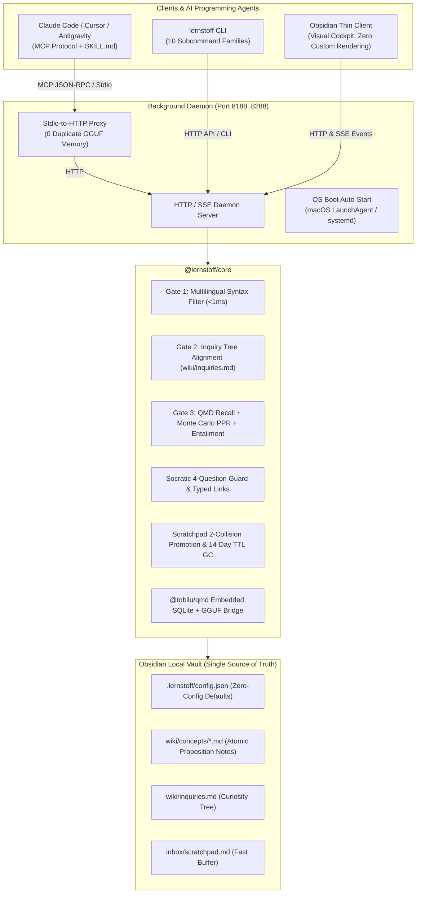

<div align="center">

# 🧠 lernstoff-wiki

**Headless Cognitive Selective Note-Taking Engine for AI Programming Agents & Obsidian**

[](https://www.typescriptlang.org/)
[](https://viteplus.dev/)
[](https://github.com/sxzz/tsdown)
[](https://zod.dev/)
[](https://modelcontextprotocol.io/)
[](https://opensource.org/licenses/MIT)

[English](README.md) · [简体中文](README.zh.md)

</div>

---

## 💡 Why `lernstoff-wiki`?

Most AI note-taking tools suffer from the **"Collector's Fallacy"**: hoarding verbatim text, raw web clips, and generic summaries into an unorganized, noisy swamp of markdown files.

`lernstoff-wiki` turns an Obsidian vault into a **living, high-signal epistemic knowledge base**. Built upon the [@tobilu/qmd](https://github.com/tobilu/qmd) vector kernel, it operates as a **dual-system engine**:

- **System 1 (Local Headless Daemon)**: Fast, deterministic, and privacy-preserving. Embeddings and reranking run locally via GGUF / Apple Metal. **Zero cloud LLM API keys required.**
- **System 2 (AI Coding Agents)**: Claude Code, Cursor, Antigravity, and OpenCode interact through an 8-tool MCP superset and the Socratic Note-Taking Protocol (`SKILL.md`).

### Core Cognitive Axioms

1. **Selective Hippocampal Gate ($\ge 75\%$ Noise Reduction)**:
   Every prospective note passes through a 3-stage gate (Syntax Position $\to$ Curiosity Inquiry Alignment $\to$ Hybrid QMD Recall & Entailment). Only true epistemic deltas survive; borderline insights defer to a fast scratchpad buffer, and redundant noise is discarded.
2. **Proposition-as-Title**:
   Concept notes must have falsifiable claim titles (e.g. `PostgreSQL MVCC Eliminates Read Locks Under Snapshot Isolation.md`), never bare noun topics (e.g. `PostgreSQL.md`).
3. **Socratic 4-Question Defense**:
   Before crystallization, the agent must explicitly defend the note's epistemic delta, state which prior belief is updated, and connect $\ge 2$ typed links.
4. **Anti-Orphan Knowledge Graph**:
   Enforces typed semantic relationships (`supports`, `contradicts`, `extends`, `qualifies`). Notes with in-degree 0 are flagged during lint audits.

---

## 🏛️ System Architecture



---

## 📦 Monorepo Packages

| Package                          | Directory                  | Description                                                                                        |
| :------------------------------- | :------------------------- | :------------------------------------------------------------------------------------------------- |
| **`@lernstoff/core`**            | `packages/core`            | Cognitive gate algorithms, QMD bridge, Zod v4 config schema, HTTP/SSE daemon, 8-tool MCP superset  |
| **`@lernstoff/cli`**             | `packages/cli`             | 10 CLI subcommands, zero-memory Stdio proxy, OS boot service installer, multi-agent skill injector |
| **`@lernstoff/obsidian-plugin`** | `packages/obsidian-plugin` | Thin client, 5-module visual settings cockpit, real-time status bar, 7 native commands             |

---

## 🚀 Quick Start

### 1. Prerequisites

- **Node.js**: $\ge 20.0.0$
- **pnpm**: $\ge 9.0.0$ (or install via Homebrew on macOS)

### 2. Installation

#### Via Homebrew (macOS)

```bash
# Install directly from local formula or tap
brew install --build-from-source Formula/lernstoff.rb

# Verify installation
lernstoff --help
```

#### Via Git & pnpm

```bash
git clone https://github.com/jsonlee/lernstoff-wiki.git
cd lernstoff-wiki
pnpm install
pnpm build
```

Link the CLI globally:

```bash
cd packages/cli && npm link
```

---

## 🛠️ Usage Guide

### Step 1: Initialize Your Vault (Zero-Config)

You can initialize any existing Obsidian vault or an empty directory:

```bash
lernstoff init --vault /path/to/my-vault
```

This creates out-of-the-box starter templates without overwriting existing notes:

- `.lernstoff/config.json`: Pre-populated with factory-recommended thresholds.
- `wiki/inquiries.md`: Starter curiosity question tree.
- `inbox/scratchpad.md`: Fast buffer table.
- `wiki/concepts/`: Evergreen proposition notes directory.
- Appends `.lernstoff/` to `.gitignore`.

### Step 2: Start the Background Daemon

```bash
# Start background daemon (detached process)
lernstoff server start --vault /path/to/my-vault --daemon

# Check status & health metrics
lernstoff server status --vault /path/to/my-vault
```

The daemon automatically selects an available port between `8188` and `8288`, writing `.lernstoff/daemon.port` and `daemon.pid`.

### Step 3: (Optional) Register OS Boot Auto-Start

Keep the daemon running seamlessly in the background across system reboots:

```bash
# On macOS: registers ~/Library/LaunchAgents/ai.lernstoff.wiki.<slug>.plist
# On Linux: registers systemd --user service
lernstoff service install --vault /path/to/my-vault

# Verify service status
lernstoff service status --vault /path/to/my-vault
```

### Step 4: Inject MCP & SKILL.md into AI Programming Agents

Connect Claude Code, Cursor, or Antigravity in one click:

```bash
# Inject into all detected agents
lernstoff skill install --vault /path/to/my-vault --target all
```

This automatically updates:

- **Claude Code**: `~/.claude.json`
- **Cursor**: `~/.cursor/mcp.json`
- **Antigravity**: `~/.gemini/config/skills/lernstoff-wiki/SKILL.md`

---

## 💻 CLI Reference (10 Subcommand Families)

```bash
# 1. Initialization
lernstoff init [--vault <path>]

# 2. Configuration Management (with dot-path support & live reload)
lernstoff config list [--vault <path>]
lernstoff config get gate.tauCore [--vault <path>]
lernstoff config set gate.tauCore 0.72 [--vault <path>]
lernstoff config reset gate [--vault <path>]

# 3. Server Lifecycle
lernstoff server <start|stop|restart|status|logs> [--daemon] [--port <n>]

# 4. OS Boot Service
lernstoff service <install|uninstall|status> [--vault <path>]

# 5. MCP Stdio-to-HTTP Proxy (Zero Memory Overhead)
lernstoff mcp [--vault <path>]

# 6. Hybrid Memory Search (with OSC-8 clickable obsidian:// terminal links)
lernstoff search "distributed consensus" --limit 5

# 7. Curiosity Inquiry Tree
lernstoff inquiry list
lernstoff inquiry add "How does LSM compaction impact read amplification?"
lernstoff inquiry close #q-01 --note "LSM-Trees Trade Read Amplification"

# 8. Fast Scratchpad Buffer
lernstoff scratchpad list
lernstoff scratchpad add "RocksDB uses Leveled Compaction by default"
lernstoff scratchpad consolidate   # Inspect multi-source collisions
lernstoff scratchpad gc            # Prune items older than 14 days

# 9. Socratic Health Audit
lernstoff lint [--json]

# 10. Agent Skills, Plugin Installation & Diagnostics
lernstoff skill <install|show> [--target <all|claude|cursor|antigravity>]
lernstoff plugin install [--vault <path>]   # One-click install plugin to Vault
lernstoff doctor [--cleanup|--pull-models]
```

---

## 🔮 Obsidian Plugin

`@lernstoff/obsidian-plugin` is a **native thin client** designed to run unobtrusively inside Obsidian:

- **Zero Custom Rendering**: Preserves Obsidian's high-performance native Markdown editor; no custom leaf views or proprietary post-processors.
- **Zero Cloud API Keys**: All cognitive filtering and embedding operations execute through the local Daemon.

### Installing the Obsidian Plugin

#### Method 1: CLI One-Click Installation (Recommended)

```bash
lernstoff plugin install --vault /path/to/my-vault
```

Then go to Obsidian **Settings $\to$ Community Plugins**, reload plugins, and enable **Lernstoff Wiki**!

#### Method 2: Manual Copy

Copy the files directly from `packages/obsidian-plugin/dist/` into your Vault's plugin directory:

```bash
mkdir -p /path/to/my-vault/.obsidian/plugins/lernstoff-wiki
cp packages/obsidian-plugin/dist/* /path/to/my-vault/.obsidian/plugins/lernstoff-wiki/
```

> [!IMPORTANT]
> **Directory Layout Requirement**: Obsidian requires `manifest.json`, `main.js`, and `styles.css` to be placed **directly** at the root of `.obsidian/plugins/lernstoff-wiki/`, not nested inside a `dist/` subfolder:
>
> ```
> <vault>/.obsidian/plugins/lernstoff-wiki/
> ├── manifest.json   ✅ At plugin root
> ├── main.js         ✅ At plugin root (self-contained bundle)
> └── styles.css      ✅ At plugin root
> ```

### Visual Configuration Cockpit (5 Modules)

Open **Settings $\to$ Lernstoff Wiki**:

1. **Daemon & OS Boot Control**: Start, stop, or restart the daemon, toggle OS boot auto-start, view recent daemon logs in a native viewer.
2. **AI Agent Integration**: One-click installation buttons for Claude Code, Cursor, and Antigravity, plus a "Copy MCP JSON" button.
3. **QMD Models & Storage**: Configure local GGUF embedding and cross-encoder reranking models.
4. **Cognitive Gate Sliders**: Adjust $\tau_{\text{off}}$, $\tau_{\text{core}}$, and $S_{\text{sem}}$ with real-time sliders and a one-click "Reset to Defaults" button.
5. **Vault Folder Mapping**: Customize paths for inquiries, scratchpad, and evergreen concept notes.

### Native Command Palette Shortcuts

- `Lernstoff: Open Curiosity Inquiries (wiki/inquiries.md)`
- `Lernstoff: Open Fast Scratchpad (inbox/scratchpad.md)`
- `Lernstoff: Append Editor Selection to Inquiries`
- `Lernstoff: Append Editor Selection to Scratchpad`
- `Lernstoff: Run Socratic Wiki Lint`
- `Lernstoff: Consolidate Scratchpad (Inspect Promotions)`
- `Lernstoff: Restart Background Daemon`

---

## 🧩 MCP Tool Superset & Protocol

For detailed parameter schemas, return types, and agent guidelines, refer to [`skills/lernstoff-wiki/SKILL.md`](skills/lernstoff-wiki/SKILL.md).

| MCP Tool                           | Purpose                                                            |
| :--------------------------------- | :----------------------------------------------------------------- |
| `lernstoff_probe_delta`            | 3-stage hippocampal novelty gate ($\ge 75\%$ noise filtering)      |
| `lernstoff_crystallize_note`       | Atomic proposition note synthesis with Socratic defense check      |
| `lernstoff_manage_inquiries`       | Curiosity tree management (`list`, `add`, `close`, `reopen`)       |
| `lernstoff_consolidate_scratchpad` | 2-collision promotion inspection & 14-day TTL garbage collection   |
| `lernstoff_lint_wiki`              | Socratic health audit (orphan notes, contradiction pairs)          |
| `lernstoff_search_memory`          | Hybrid search + 2-hop Monte Carlo PPR associative walk             |
| `lernstoff_get_note`               | Note retrieval with line slicing (`path:from:count`) and backlinks |
| `lernstoff_status`                 | Global vault metrics, inquiries, and scratchpad statistics         |
| `lernstoff://{+path}`              | Direct note content resource streaming                             |

---

## 🛠️ Development & Building

The project is built with **Vite+ (`vp`)** and **`tsdown`**:

```bash
# Type check and format check across all packages
pnpm check

# Run all 13 test suites (63 tests)
pnpm test

# Build all packages simultaneously (powered by tsdown -W)
pnpm build
```

---

## 📄 License

MIT © [JsonLee12138](https://github.com/JsonLee12138)
