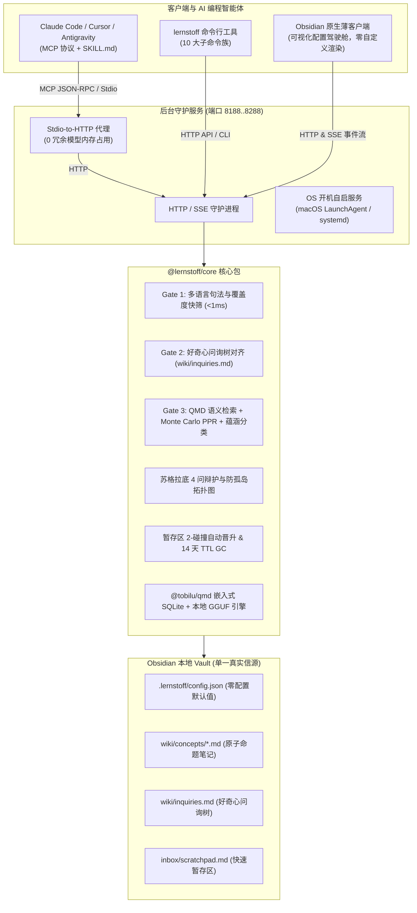

<div align="center">

# 🧠 lernstoff-wiki

**面向 AI 编程智能体与 Obsidian 的无头认知选择性笔记引擎**

[](https://www.typescriptlang.org/)
[](https://viteplus.dev/)
[](https://github.com/sxzz/tsdown)
[](https://zod.dev/)
[](https://modelcontextprotocol.io/)
[](https://opensource.org/licenses/MIT)

[English](README.md) · [简体中文](README.zh.md)

</div>

---

## 💡 为什么需要 `lernstoff-wiki`？

当前主流的 AI 笔记工具普遍患有**“收藏家谬误（Collector's Fallacy）”**：一股脑将原文、网页剪藏与泛泛的摘要塞入笔记库，最终导致知识库沦为杂乱无章、充满噪音的垃圾堆。

`lernstoff-wiki` 将你的 Obsidian 知识库转变为一个**高信噪比、有自我辩护能力的认知常青知识库**。底层依托 [@tobilu/qmd](https://github.com/tobilu/qmd) 嵌入式向量内核，采用**双系统认知架构**：

- **系统 1（本地常驻守护进程 Daemon）**：毫秒级响应、确定性规则与隐私安全。向量检索与 Cross-Encoder Rerank 全部在本地通过 GGUF / Apple Metal 加速运行。**完全零云端 LLM API Key 依赖**。
- **系统 2（外部 AI 编程智能体）**：Claude Code、Cursor、Antigravity 与 OpenCode 通过 8 大工具的 MCP 超集以及苏格拉底选择性笔记协议（`SKILL.md`）与知识库深度交互。

### 核心认知公理

1. **海马体三阶认知网关（$\ge 75\%$ 噪音过滤）**：
   任何候选知识点在写入前必须经过三阶门控（句法位置初筛 $\to$ 好奇心问询树对齐 $\to$ QMD 混合召回与蕴涵分类）。仅有真正具备认知增量的命题得以留存；边界模糊的见解沉降到快速暂存区；冗余与跑题内容静默丢弃。
2. **命题即文件名（Proposition-as-Title）**：
   概念笔记标题必须是**可证伪的完整命题句**（如 `PostgreSQL MVCC Eliminates Read Locks Under Snapshot Isolation.md`），严禁使用空洞的名词短语（如 `PostgreSQL.md` 或 `MVCC.md`）。
3. **苏格拉底四问自辩护**：
   结晶为永久笔记前，智能体必须明确回答：相比已有笔记带来了何种不可替代的新机制？修正了哪项既有认知？并连接至少 2 个具名逻辑谓词关系。
4. **反孤岛有向图拓扑**：
   强制标注强类型逻辑关系（`supports`、`contradicts`、`extends`、`qualifies`）。全库巡检工具会自动捕获入度为 0 的孤岛节点与未调和的矛盾命题对。

---

## 🏛️ 系统架构全景



---

## 📦 代码仓库结构

| 软件包                           | 目录                       | 职责说明                                                                             |
| :------------------------------- | :------------------------- | :----------------------------------------------------------------------------------- |
| **`@lernstoff/core`**            | `packages/core`            | 纯认知网关算法、QMD 桥接、Zod v4 配置 Schema、HTTP/SSE 守护服务、8 工具 MCP 核心实现 |
| **`@lernstoff/cli`**             | `packages/cli`             | 10 大子命令族、零内存占用 Stdio 代理、操作系统开机自启服务管理、多智能体协议一键注入 |
| **`@lernstoff/obsidian-plugin`** | `packages/obsidian-plugin` | Obsidian 原生薄客户端插件、5 模块可视化配置驾驶舱、实时状态栏、7 大原生命令          |

---

## 🚀 极速上手

### 1. 环境准备

- **Node.js**: $\ge 20.0.0$
- **pnpm**: $\ge 9.0.0$（或 macOS Homebrew）

### 2. 安装方式

#### 方式 A：通过 Homebrew (macOS)

```bash
# 从本地配方直接构建安装
brew install --build-from-source Formula/lernstoff.rb

# 验证安装
lernstoff --help
```

#### 方式 B：通过源码与 pnpm

```bash
git clone https://github.com/jsonlee/lernstoff-wiki.git
cd lernstoff-wiki
pnpm install
pnpm build
```

全局链接 CLI：

```bash
cd packages/cli && npm link
```

---

## 🛠️ 使用步骤

### 第一步：零配置初始化知识库

可对任意现有 Obsidian Vault 或空目录执行初始化：

```bash
lernstoff init --vault /path/to/my-vault
```

命令将自动创建开箱即用的模板（绝不覆盖用户原有笔记）：

- `.lernstoff/config.json`：预填出厂最优算法参数。
- `wiki/inquiries.md`：好奇心问询问题树。
- `inbox/scratchpad.md`：快速暂存 Markdown 表格。
- `wiki/concepts/`：常青原子命题笔记存放目录。
- 自动更新 Vault 根目录 `.gitignore` 添加 `.lernstoff/`。

### 第二步：启动常驻后台服务

```bash
# 以守护进程模式在后台启动
lernstoff server start --vault /path/to/my-vault --daemon

# 查看服务状态与健康指标
lernstoff server status --vault /path/to/my-vault
```

守护进程会自动在 `8188` 到 `8288` 端口区间探测空闲端口，并写入 `.lernstoff/daemon.port` 与 `daemon.pid`。

### 第三步：（可选）注册系统开机自启

让服务在每次开机或重启后无感常驻后台：

```bash
# macOS 自动生成 ~/Library/LaunchAgents/ai.lernstoff.wiki.<slug>.plist
# Linux 自动生成 systemd --user 服务单元
lernstoff service install --vault /path/to/my-vault

# 查看服务状态
lernstoff service status --vault /path/to/my-vault
```

### 第四步：一键注入 AI 编程智能体

为 Claude Code、Cursor 或 Antigravity 一键装载 MCP 与认知规范：

```bash
# 一键注入到本机检测到的所有智能体
lernstoff skill install --vault /path/to/my-vault --target all
```

该命令会自动同步：

- **Claude Code**：`~/.claude.json`
- **Cursor**：`~/.cursor/mcp.json`
- **Antigravity**：`~/.gemini/config/skills/lernstoff-wiki/SKILL.md`

---

## 💻 CLI 命令完全参考（10 大子命令族）

```bash
# 1. 知识库初始化
lernstoff init [--vault <path>]

# 2. 配置管理（支持点分路径查询修改，修改后实时通知 Daemon 重载）
lernstoff config list [--vault <path>]
lernstoff config get gate.tauCore [--vault <path>]
lernstoff config set gate.tauCore 0.72 [--vault <path>]
lernstoff config reset gate [--vault <path>]

# 3. 守护服务管理
lernstoff server <start|stop|restart|status|logs> [--daemon] [--port <n>]

# 4. 操作系统开机自启服务
lernstoff service <install|uninstall|status> [--vault <path>]

# 5. MCP Stdio-to-HTTP 零内存中继代理
lernstoff mcp [--vault <path>]

# 6. 混合语义检索（终端输出可直接点击 OSC-8 obsidian:// 链接跳转至笔记）
lernstoff search "分布式共识机制" --limit 5

# 7. 好奇心问询树维护
lernstoff inquiry list
lernstoff inquiry add "LSM 压缩机制如何权衡写放大与读放大？"
lernstoff inquiry close #q-01 --note "LSM-Trees Trade Read Amplification"

# 8. 快速暂存区维护
lernstoff scratchpad list
lernstoff scratchpad add "RocksDB 默认使用 Leveled Compaction 策略"
lernstoff scratchpad consolidate   # 扫描 >=2 次多源碰撞的候选知识点
lernstoff scratchpad gc            # 自动归档超过 14 天未晋升的陈旧条目

# 9. 苏格拉底知识库全局巡检
lernstoff lint [--json]

# 10. 智能体集成、插件安装与环境诊断
lernstoff skill <install|show> [--target <all|claude|cursor|antigravity>]
lernstoff plugin install [--vault <path>]   # 一键安装 Obsidian 插件至 Vault
lernstoff doctor [--cleanup|--pull-models]
```

---

## 🔮 Obsidian 插件（可视化配置驾驶舱）

`@lernstoff/obsidian-plugin` 是专为 Obsidian 打造的**原生薄客户端**：

- **零自定义渲染干扰**：不篡改任何 Markdown 视图或代码块渲染逻辑，保持 Obsidian 原生 Markdown 编辑器的高效与流畅。
- **零云端 API Key**：所有检索、嵌入与网关计算均由后台常驻 Daemon 承担。

### 安装 Obsidian 插件

#### 方式一：CLI 一键自动安装（最简单推荐）

```bash
# 直接将插件安装并启用至指定 Vault
lernstoff plugin install --vault /path/to/my-vault
```

在 Obsidian 的「设置 $\to$ 社区插件」中重新加载即可看到并启用！

#### 方式二：手动复制安装

直接复制构建好的 `packages/obsidian-plugin/dist/` 下的 3 个文件到 Vault 的插件目录中：

```bash
mkdir -p /path/to/my-vault/.obsidian/plugins/lernstoff-wiki
cp packages/obsidian-plugin/dist/* /path/to/my-vault/.obsidian/plugins/lernstoff-wiki/
```

> [!IMPORTANT]
> **目录层级要求**：Obsidian 要求 `manifest.json`、`main.js`、`styles.css` 必须直接平铺位于 `.obsidian/plugins/lernstoff-wiki/` 根目录下，**千万不能多套一层 `dist/` 文件夹**！
>
> ```
> <vault>/.obsidian/plugins/lernstoff-wiki/
> ├── manifest.json   ✅ 必须在根目录
> ├── main.js         ✅ 必须在根目录（单文件打包完整依赖）
> └── styles.css      ✅ 必须在根目录
> ```

### 5 大可视化配置模块

进入 **Settings（设置） $\to$ Lernstoff Wiki**：

1. **服务与开机自启控制**：查看当前运行端口与 PID，一键启动/重启/停止后台服务，配置随系统开机启动，内嵌最近日志查看器。
2. **AI 智能体一键接入**：提供 Claude Code、Cursor、Antigravity 一键写入按钮及手动复制 MCP JSON 按钮。
3. **QMD 本地模型与索引**：配置本地 GGUF Embedding 与 Reranker 模型路径。
4. **海马体认知网关滑块**：可视化微调 $\tau_{\text{off}}$、$\tau_{\text{core}}$ 与语义冗余阈值 $S_{\text{sem}}$，提供“恢复出厂推荐值”按钮。
5. **知识库目录映射**：自定义问询树、暂存区及概念笔记在 Vault 内的存储路径。

### 原生命令面板（Command Palette）支持

- `Lernstoff: Open Curiosity Inquiries (wiki/inquiries.md)` - 打开好奇心问询树
- `Lernstoff: Open Fast Scratchpad (inbox/scratchpad.md)` - 打开快速暂存区
- `Lernstoff: Append Editor Selection to Inquiries` - 将编辑器选中内容追加至问询树
- `Lernstoff: Append Editor Selection to Scratchpad` - 将编辑器选中内容追加至暂存区
- `Lernstoff: Run Socratic Wiki Lint` - 触发苏格拉底全局健康巡检
- `Lernstoff: Consolidate Scratchpad (Inspect Promotions)` - 检查暂存区可晋升命题
- `Lernstoff: Restart Background Daemon` - 重启后台守护进程

---

## 🧩 MCP 工具超集与智能体协议

详细的工具参数 Schema 与最佳实践说明请参阅 [`skills/lernstoff-wiki/SKILL.md`](skills/lernstoff-wiki/SKILL.md)。

| MCP 工具                           | 核心职能                                                |
| :--------------------------------- | :------------------------------------------------------ |
| `lernstoff_probe_delta`            | 三阶海马体增量门控筛查（实现 $\ge 75\%$ 噪音拦截）      |
| `lernstoff_crystallize_note`       | 苏格拉底 4 问防御检查与原子命题笔记结晶                 |
| `lernstoff_manage_inquiries`       | 好奇心问询树管理（`list` / `add` / `close` / `reopen`） |
| `lernstoff_consolidate_scratchpad` | 暂存区 2-碰撞自动晋升识别与 14 天 TTL 归档              |
| `lernstoff_lint_wiki`              | 知识库健康体检（孤岛笔记与未调和命题矛盾检测）          |
| `lernstoff_search_memory`          | 混合检索 + 2-Hop 蒙特卡洛 PPR 联想游走扩展              |
| `lernstoff_get_note`               | 精准行号切片（`path:from:count`）与反向链接提取         |
| `lernstoff_status`                 | 知识库健康度、活跃问询数与暂存区实时指标快照            |
| `lernstoff://{+path}`              | 动态 Resource 直读笔记 Markdown 原文                    |

---

## 🛠️ 本地开发与测试

本项目采用 **Vite+ (`vp`)** 与 **`tsdown`**：

```bash
# 执行类型检查与代码格式校验
pnpm check

# 运行全套 13 个测试套件（63 项测试）
pnpm test

# 并行构建所有软件包（由 tsdown -W 驱动）
pnpm build
```

---

## 📄 开源许可证

MIT © [JsonLee12138](https://github.com/JsonLee12138)
