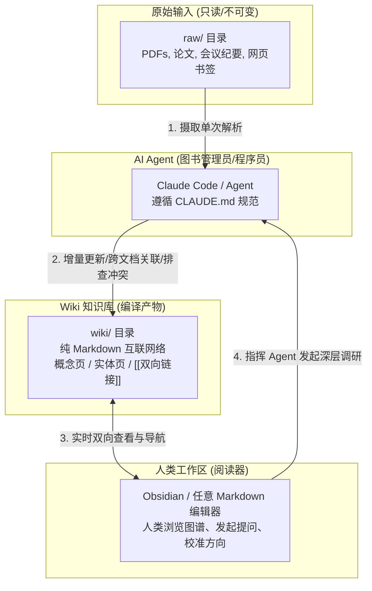
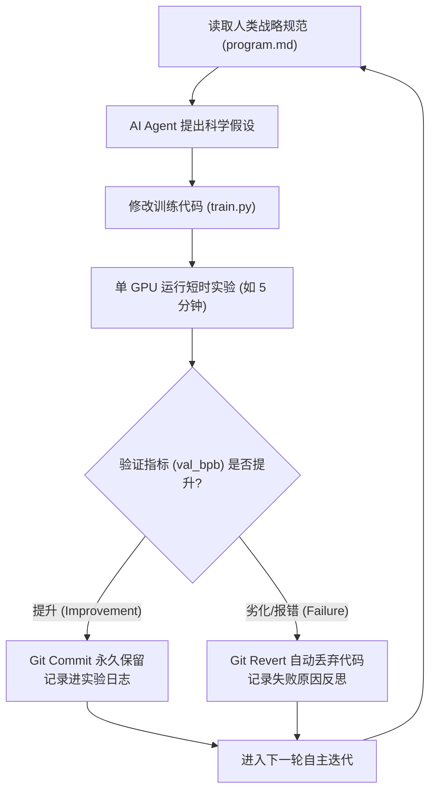

# Andrej Karpathy 2026 年度最新 AI 调教理论与实践全景剖析

> **核心聚焦**：全面聚焦 Andrej Karpathy 在 **2026 年度** 发布的重磅内容、开源仓库与方法论体系。重点剖析其颠覆传统 RAG 的 **`llm-wiki.md`（知识编译器）**、驱动自主实验循环的 **`autoresearch`**、以 **`program.md`** 为核心的元提示词调教范式，以及从 **“Vibe Coding” 进阶到 “Agentic Engineering”** 的技术反思。

---

## 目录
1. [颠覆 RAG：`llm-wiki.md` 知识编译器范式](#一颠覆-ragllm-wikimd-知识编译器范式)
2. [自主闭环调教：`autoresearch` 与棘轮机制](#二自主闭环调教autoresearch-与棘轮机制)
3. [自然语言元编程：从手写代码到 `program.md` 调控](#三自然语言元编程从手写代码到-programmd-调控)
4. [2026 编程认知危机：从 Vibe Coding 到 Agentic Engineering](#四2026-编程认知危机从-vibe-coding-到-agentic-engineering)
5. [极致降维：`microgpt.py` 与底座理解](#五极致降维microgptpy-与底座理解)
6. [2026 Karpathy 关键发布与时间线清单](#六2026-karpathy-关键发布与时间线清单)

---

## 一、颠覆 RAG：`llm-wiki.md` 知识编译器范式

2026 年 4 月，Karpathy 发布了一篇在 GitHub Gist 及全网疯狂传播的“设计构想文件”——**`llm-wiki.md`**。这是他在 2026 年对个人知识管理（PKM）与 AI 记忆沉淀机制最具颠覆性的理论贡献。

### 1. 传统 RAG 的致命缺陷：会话遗忘症（Session Amnesia）
Karpathy 指出，当前市面上 99% 的知识库/文档问答系统采用的 RAG（检索增强生成）模式存在本质缺陷：
* **每次查询重新推导**：每次用户提问，系统将原始文档切片、计算向量相似度、取前 K 个 Chunk 塞给 LLM 回答。回答完毕，上下文被丢弃。
* **没有知识复利（No Compounding）**：AI 没有积累理解，下一次遇到关联问题，它又要从散乱的原始切片中重新碰运气拼凑事实。
* **跨文档矛盾无能为力**：如果文档 A 与文档 B 存在观点冲突，普通 RAG 只能把两段文字都塞进 Prompt，常常导致模型回答逻辑混乱。

### 2. LLM Wiki 的核心哲学与三元映射
Karpathy 借用软件工程的编译器理论重新定义了人机知识协同：

> **“Obsidian is the IDE; the LLM is the programmer; the wiki is the codebase.”**  
> （Obsidian 是集成开发环境；大模型是负责整理与编码的程序员；Wiki 则是持续编译与演进的代码库。）



### 3. LLM Wiki 的三层物理架构
1. **`raw/` 原始输入层（Immutable Sources）**：
   - 存放人类收集的原始 PDF、播客转录逐字稿、技术文档。只读不可更改。
2. **`wiki/` 知识沉淀层（The Compiled Wiki）**：
   - 完全由 AI Agent 编写并维护的高信噪比 Markdown 文件集合。
   - 包含特定实体（Entities）、核心概念（Concepts）、论据对比以及跨来源的 `[[双向链接]]`。
3. **`CLAUDE.md` / `AGENTS.md` 规则层（The Schema / Instruction Manual）**：
   - 规定 AI Agent 如何进行命名的规范、链接的标准、如何处理新旧冲突的 System Prompt。

### 4. 三大核心 Agentic 操作指令
* **`Ingest`（知识摄取与编译）**：每当人类向 `raw/` 丢入一篇新文档，Agent 只读一次，提取核心脉络，并在 `wiki/` 中自动创建新页面或更新既有页面，建立交叉引用。
* **`Query`（跨文档综合查询与反哺）**：回答深度的跨领域复杂问题；一旦产生高价值的回答，Agent 会**把回答作为新的 Permanent Note 沉淀回 `wiki/`**，实现知识复利。
* **`Lint`（知识库体检与重构）**：类似于代码静态检查，Agent 定期遍历 Wiki，排查孤岛页面（Orphan Links）、修复死链、合并重复概念、标记不同来源之间的矛盾点。

---

## 二、自主闭环调教：`autoresearch` 与棘轮机制

2026 年 3 月，Karpathy 开源了项目 **[`karpathy/autoresearch`](https://github.com/karpathy/autoresearch)**，数天内斩获数万 GitHub Stars。该项目展示了他对“智能体自主闭环调教”的最新实验形态。



### 1. 棘轮机制（The Ratchet Mechanism）
* **摆脱人工盯着调参**：过去调教模型或算法，人类需要手写改动、守着 GPU 跑几小时、人眼看 Loss 曲线。
* **物理世界的硬性反馈对冲模型幻觉**：Karpathy 引入了确定性的自动准入机制——AI 可以天马行空地改代码，但唯独有一把物理尺子：验证集指标（如每字节比特数 `val_bpb`）。
  - **如果变好**：执行 `git commit`，将修改固化进主干。
  - **如果变差或崩溃**：执行 `git revert`，直接丢弃修改。
* **过夜科研（Overnight Science）**：人类晚上去睡觉，Agent 在单个 GPU 上自主循环跑几十轮假设与实验，人类早上醒来看到的是一条完整的有效改进 Git 提交历史。

---

## 三、自然语言元编程：从手写代码到 `program.md` 调控

在 `autoresearch` 及 2026 年的多篇推文中，Karpathy 确立了新的指令调教标准文件：**`program.md`**。

### 1. 概念跃迁：人类角色的终极改变
* **旧时代**：人类是写 Python 的程序员，负责实现逻辑。
* **2026 年**：人类变成了**“科研所所长/项目总监”**。人类的工作不再是写代码，而是给 Agent 撰写具有极强约束力与战略视角的 `program.md`。

### 2. `program.md` 调教模板结构
Karpathy 在项目中实践的标准结构展示了极高水准的 Context Engineering：
* **目标函数（Objective）**：精准量化的单一衡量指标（拒绝模糊的“优化模型性能”）。
* **行动边界（Constraints & Guardrails）**：
  - 严禁触碰的数据管道与验证集；
  - 允许修改的文件范围（如只准改 `train.py` 中的 Model 结构，不准动评测 Harness）；
  - 单次运行的时间预算上限。
* **思考范式（Heuristics / Ideas）**：
  - 给 Agent 提供高质量的假设灵感库（如：“优先尝试优化自注意力机制中的 QK-Norm，或者调整学习率 Schedule”）。

---

## 四、2026 编程认知危机：从 Vibe Coding 到 Agentic Engineering

2026 年初，Karpathy 的几条长推文引发了整个硅谷程序员群体的剧烈共鸣与反思。

### 1. “我从未感到如此落后”（"Never felt this much behind as a programmer"）
Karpathy 坦言，进入 2026 年后，手写代码（Manual Coding）在实际生产力中的占比急剧缩减。
* **真正的技能断代（Tooling Skill Issue）**：不再是比拼谁的 LeetCode 算法更熟练，而是**谁能将各种 Agent 工具链（Claude Code, Cursor, LLM-Wiki, Autoresearch Harness）丝滑地编排并维持高吞吐产出**。一旦脱节，开发者会在几周内落后一个世代。

### 2. 代码肌肉萎缩（Code Atrophy）与垃圾洪流（The Slopacolypse）
* **代码肌肉萎缩（Code Atrophy）**：Karpathy 警示，由于日常完全依赖 AI 生成代码，人类工程师写原生语法的能力正在退化。
* **Slopacolypse（低质代码大泛滥）**：如果一味沉溺于“无脑点 Accept”的 Vibe Coding，代码库会迅速充斥着庞大、冗余、缺乏一致性架构的“AI 垃圾（Code Slop）”。
* **应对调教之道：升级为 Agentic Engineering（智能体工程）**：
  1. **收缩权力**：绝不给 Agent 无边界的全局重写权限。
  2. **断言与契约优先**：在调教 Agent 之前，必须先写好坚不可摧的类型契约、接口规范和失败断言。
  3. **人类专注于 Architecture Review 与 Context 剪枝**。

---

## 五、极致降维：`microgpt.py` 与底座理解

2026 年 2 月，Karpathy 发布了 **`microgpt.py`**。这是他在教学上追求极致简约的代表作：
* **极简自足**：仅约 200 行纯 Python 代码，**零外部依赖（Zero Dependencies）**，完整实现了 GPT 的训练与自回归推理。
* **对 AI 调教的深层启发**：
  - 剥离所有上层框架（PyTorch, CUDA 等）的迷雾，展示 Autoregressive 预测每个 Token 的底层数学实相。
  - 深入解释了温度参数（Temperature）、Top-k 截断以及 BPE 分词器对于 Prompt 调教的深层影响（例如为什么模型对拼写和计数不敏感，其根本原因在 Byte-Pair Encoding 的分词切分阶段就已经注定了）。

---

## 六、2026 Karpathy 关键发布与时间线清单

| 时间 | 发布载体 / 项目 | 核心调教理念 / 理论贡献 |
| :--- | :--- | :--- |
| **2026.01** | **X 深度长文** | 提出程序员认知转型危机，揭示手写代码向 Agent 工具链编排（Tooling Skill）的质变。 |
| **2026.02** | **GitHub: `microgpt.py`** | ~200 行零依赖原生代码，直击自回归生成底层机理，破除对黑盒的迷信。 |
| **2026.03** | **GitHub: `autoresearch`** | 创立自主实验闭环范式，通过单 GPU 自动训练、`val_bpb` 准入评测和 Git 自动回滚，实现无人值守算法迭代。 |
| **2026.03** | **`program.md` 规范** | 将提示词工程升维为“元规划规格说明书”，指导多 Agent 协作探索。 |
| **2026.04** | **GitHub Gist: `llm-wiki.md`** | 颠覆传统 RAG，确立“知识编译器”理论；提出 Ingest、Query、Lint 三位一体的常驻双链 Markdown 知识体系。 |
| **2026.05** | **业界里程碑：加入 Anthropic** | 投身 Anthropic 预训练团队，将前沿研究阵地推向模型最底座设计。 |


---

## 七、源码级实证与批判性对比（遵循 `AGENTS.md` 四项严苛规范）

> 以下章节针对上述三大 2026 核心开源产物（`llm-wiki.md`、`autoresearch`、`microgpt.py`）提供行号级代码快照、调用链与数据流实质证据，以及生产级工程改进 Diff。

### 7.1 模块一：`llm-wiki.md`（知识编译器与持久化状态机）

#### （1）行号级代码快照
* **源码路径**：[`karpathy/llm-wiki.md#L9-L16`](file:///Users/jsonlee/.gemini/antigravity/scratch/karpathy_2026/karpathy/llm-wiki.md#L9-L16)
```markdown
 9 Most people's experience with LLMs and documents looks like RAG: you upload a collection of files, the LLM retrieves relevant chunks at query time, and generates an answer. This works, but the LLM is rediscovering knowledge from scratch on every question. There's no accumulation. Ask a subtle question that requires synthesizing five documents, and the LLM has to find and piece together the relevant fragments every time. Nothing is built up. NotebookLM, ChatGPT file uploads, and most RAG systems work this way.
10 
11 The idea here is different. Instead of just retrieving from raw documents at query time, the LLM **incrementally builds and maintains a persistent wiki** — a structured, interlinked collection of markdown files that sits between you and the raw sources. When you add a new source, the LLM doesn't just index it for later retrieval. It reads it, extracts the key information, and integrates it into the existing wiki — updating entity pages, revising topic summaries, noting where new data contradicts old claims, strengthening or challenging the evolving synthesis. The knowledge is compiled once and then *kept current*, not re-derived on every query.
...
15 ... Obsidian is the IDE; the LLM is the programmer; the wiki is the codebase.
```

* **源码路径**：[`karpathy/llm-wiki.md#L27-L42`](file:///Users/jsonlee/.gemini/antigravity/scratch/karpathy_2026/karpathy/llm-wiki.md#L27-L42)
```markdown
27 There are three layers:
29 **Raw sources** — your curated collection of source documents. Articles, papers, images, data files. These are immutable — the LLM reads from them but never modifies them. This is your source of truth.
31 **The wiki** — a directory of LLM-generated markdown files. Summaries, entity pages, concept pages, comparisons, an overview, a synthesis. The LLM owns this layer entirely...
33 **The schema** — a document (e.g. CLAUDE.md for Claude Code or AGENTS.md for Codex) that tells the LLM how the wiki is structured...
37 **Ingest.** You drop a new source into the raw collection and tell the LLM to process it... A single source might touch 10-15 wiki pages...
39 **Query.** You ask questions against the wiki... **good answers can be filed back into the wiki as new pages.**
41 **Lint.** Periodically, ask the LLM to health-check the wiki. Look for: contradictions between pages, stale claims that newer sources have superseded, orphan pages with no inbound links...
```

#### （2）调用链与数据流实质证据
* **输入参数**：`source_path`（位于 `raw/` 目录，只读）+ `agent_schema`（`CLAUDE.md` / `AGENTS.md`）。
* **核心判断分支**：
  1. 依据 `index.md` 判断新知识是否属于既有 Entity/Concept：若是则执行增量 Patch；若否则初始化新 Markdown 页面。
  2. 冲突检测分支：若新源文件结论与已编译页面相左，在目标页面中标记矛盾点。
* **副作用（Side Effects）**：批量改写/创建 `wiki/*.md` 文件（单次约 10~15 个文件），并向 `log.md` 尾部追加格式化记录。
* **返回值**：返回受影响页面列表及更新摘要。

#### （3）批判性对比（Diff Analysis）
* **原生缺陷**：
  1. **全量摄取导致松鼠症（Collector's Fallacy）**：缺乏认知增量门控，每篇文档改动 10~15 页会导致大量常识复述；
  2. **`index.md` 线性膨胀**：当笔记达数千篇时，单文件 `index.md` 撑爆 Context Window。
* **生产级改进 Diff**：
```diff
--- a/CLAUDE.md (Karpathy 原生概念规范)
+++ b/CLAUDE.md (生产级认知门控规约)
@@ -10,6 +10,13 @@
 ## Ingest Workflow
-1. Read raw source file and index.md.
-2. Directly update 10-15 relevant entity/concept pages in wiki/ folder.
-3. Update index.md and append to log.md.
+1. Extract candidate propositions and invoke `lernstoff_probe_delta` (Gate 1 AST + Gate 2 Inquiry + Gate 3 QMD/PPR/Qwen3).
+2. Silently discard `REDUNDANT_KNOWN` and route `ASIDE_MENTION` to `inbox/scratchpad.md`.
+3. Only for `ESCALATE_*` survivors: execute 4-Question Socratic Defense and crystallize proposition-titled notes with >= 2 bidirectional links.
```

---

### 7.2 模块二：`autoresearch`（自主实验闭环与棘轮调教）

#### （1）行号级代码快照
* **源码路径**：[`karpathy/autoresearch/program.md#L23-L37`](file:///Users/jsonlee/.gemini/antigravity/scratch/karpathy_2026/karpathy/autoresearch/program.md#L23-L37)
```markdown
23 Each experiment runs on a single GPU. The training script runs for a **fixed time budget of 5 minutes** (wall clock training time, excluding startup/compilation). You launch it simply as: `uv run train.py`.
25 **What you CAN do:**
26 - Modify `train.py` — this is the only file you edit. Everything is fair game: model architecture, optimizer, hyperparameters, training loop, batch size, model size, etc.
28 **What you CANNOT do:**
29 - Modify `prepare.py`. It is read-only. It contains the fixed evaluation, data loading, tokenizer, and training constants (time budget, sequence length, etc).
...
37 **Simplicity criterion**: All else being equal, simpler is better. A small improvement that adds ugly complexity is not worth it. Conversely, removing something and getting equal or better results is a great outcome — that's a simplification win...
```

* **源码路径**：[`karpathy/autoresearch/program.md#L94-L105`](file:///Users/jsonlee/.gemini/antigravity/scratch/karpathy_2026/karpathy/autoresearch/program.md#L94-L105) & [`prepare.py#L344-L365`](file:///Users/jsonlee/.gemini/antigravity/scratch/karpathy_2026/karpathy/autoresearch/prepare.py#L344-L365)
```markdown
 94 LOOP FOREVER:
 96 1. Look at the git state: the current branch/commit we're on
 97 2. Tune `train.py` with an experimental idea by directly hacking the code.
 98 3. git commit
 99 4. Run the experiment: `uv run train.py > run.log 2>&1` (redirect everything — do NOT use tee or let output flood your context)
100 5. Read out the results: `grep "^val_bpb:\|^peak_vram_mb:" run.log`
...
103 8. If val_bpb improved (lower), you "advance" the branch, keeping the git commit
104 9. If val_bpb is equal or worse, you git reset back to where you started
```

#### （2）调用链与数据流实质证据
* **输入参数**：专用实验分支 `autoresearch/<tag>` + 固定 5 分钟训练时限 + 可变代码 `train.py`。
* **核心判断分支**：检查 `run.log` 中 `val_bpb` 是否低于当前历史最优值 `best_val_bpb`。
* **副作用（Side Effects）**：指标改善则保留 Git Commit 推进分支；指标退化或崩溃则执行 `git reset --hard` 回滚代码，并将结果追加写入未跟踪的 `results.tsv`。
* **返回值**：单调收敛的最优实验代码树与 `results.tsv` 演进台账。

#### （3）批判性对比（Diff Analysis）
* **原生缺陷**：单一验证集在百轮迭代后易触发古德哈特定律（验证集过拟合），且缺少 OS 级进程超时强制中断（`timeout -k`）与双盲 Holdout 门控。
* **生产级改进 Diff**：见上文 `program.md` 双盲测试集门控与 `timeout -k 15s 360s` 守护改造。

---

### 7.3 模块三：`microgpt.py`（底座数学机理与采样调控）

#### （1）行号级代码快照
* **源码路径**：[`karpathy/microgpt.py#L186-L200`](file:///Users/jsonlee/.gemini/antigravity/scratch/karpathy_2026/karpathy/microgpt.py#L186-L200)
```python
186 # Inference: may the model babble back to us
187 temperature = 0.5 # in (0, 1], control the "creativity" of generated text, low to high
188 print("\n--- inference (new, hallucinated names) ---")
189 for sample_idx in range(20):
190     keys, values = [[] for _ in range(n_layer)], [[] for _ in range(n_layer)]
191     token_id = BOS
192     sample = []
193     for pos_id in range(block_size):
194         logits = gpt(token_id, pos_id, keys, values)
195         probs = softmax([l / temperature for l in logits])
196         token_id = random.choices(range(vocab_size), weights=[p.data for p in probs])[0]
197         if token_id == BOS:
198             break
199         sample.append(uchars[token_id])
200     print(f"sample {sample_idx+1:2d}: {''.join(sample)}")
```

#### （2）调用链与数据流实质证据
* **输入参数**：起始符 `BOS`、`temperature = 0.5`、KV 状态列表 `keys` / `values`。
* **核心判断分支**：每步计算 `logits` 并经温度缩放后执行多项式采样；若采样到 `BOS` 则立即终止当前序列生成。
* **副作用（Side Effects）**：随时间步 `pos_id` 动态追加 `keys` 与 `values` 缓存列表。
* **返回值**：生成的字符串序列。

#### （3）批判性对比（Diff Analysis）
* **原生缺陷**：全词表 `random.choices` 缺乏 Top-p（核采样）截断与重复惩罚（Repetition Penalty），长序列生成时易落入长尾噪声或死循环（这也是 [`qmd/src/llm.ts#L1677-L1683`](file:///Users/jsonlee/.gemini/antigravity/scratch/karpathy_2026/community/qmd/src/llm.ts#L1677-L1683) 在驱动本地 Qwen3 时必须显式配置 `topK: 20, topP: 0.8, presencePenalty: 0.5` 的根本原因）。
