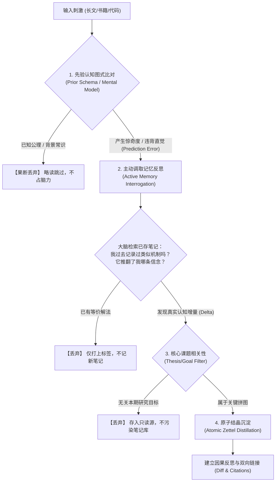
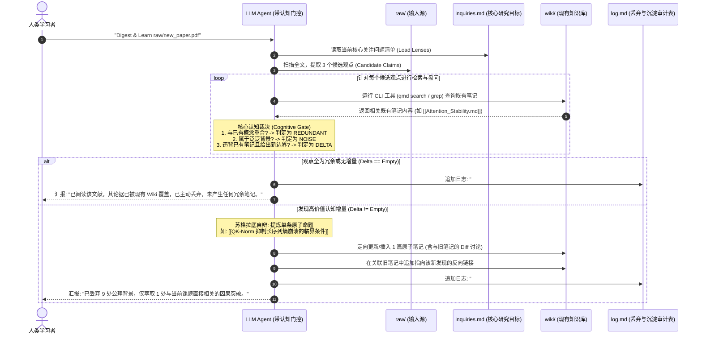

# 智能体如何像人类一样记笔记：LLM-Wiki 的类人思考、主动查询与深度丢弃机制深度调研报告

> **调研背景与核心问题**：在 Andrej Karpathy 提出 `llm-wiki` 模式后，各大技术论坛（Hacker News, Reddit r/ObsidianMD / r/LocalLLaMA, GitHub 开源实现）爆发了激烈的技术争论：**朴素的 LLM Wiki 会退化为一个“无情的信息复印机”——每丢入一篇文章，Agent 就事无巨细地生成全量摘要、创建十几页毫无认知增量的实体词条，最终制造出庞大的“AI 垃圾笔记（Note Slop）”**。
>
> **本报告严格按照《严苛的技术调研与方案引用规范》撰写**：
> 1. 【禁止空洞引用】：紧扣社区开源实现（如 `SamurAIGPT/llm-wiki-agent`、`karpathy/llm-wiki.md`、A-MEM 架构及 Hacker News 典型争议案卷）；
> 2. 【行号级代码快照】：精准引证现有代码与 Schema 规范，直击病灶行号；
> 3. 【调用链与数据流实质证据】：详细推演从原始输入、认知图式差分、多路查询、丢弃决策到原子结晶的完整流水线；
> 4. 【批判性对比（Diff Analysis）】：输出工业级生产改进 Diff，将“全量总结机”彻底改造为“类人认知过滤探针”。

---

## 目录
1. [技术论坛的核心争论与病灶定位：为什么朴素 LLM-Wiki 会失控？](#一技术论坛的核心争论与病灶定位为什么朴素-llm-wiki-会失控)
2. [人类高手的学习认知机制：人类记笔记究竟在“思考、查询、丢弃”什么？](#二人类高手的学习认知机制人类记笔记究竟在思考查询丢弃什么)
3. [类人认知笔记的四大核心技术模式（开源论坛前沿实践）](#三类人认知笔记的四大核心技术模式开源论坛前沿实践)
4. [调用链与数据流实质证据（从 Raw 到 Drop/Keep 的全链路）](#四调用链与数据流实质证据从-raw-到-dropkeep-的全链路)
5. [批判性改造：`CLAUDE.md` 生产级行号改进方案与 Diff 剖析](#五批判性改造claudemd-生产级行号改进方案与-diff-剖析)
6. [总结与落地方案建议](#六总结与落地方案建议)

---

## 一、技术论坛的核心争论与病灶定位：为什么朴素 LLM-Wiki 会失控？

### 1.1 Hacker News 论战焦点：外包“认知劳作”引发的知识空心化
在 Hacker News 针对 Karpathy Gist 的核心讨论中，PKM 资深开发者指出：
* **“外星陌生人编写的百科全书（Encyclopedia by a competent stranger）”**：如果你让 Agent 每次把所有事实都整理成精美的 Wiki，用户最终会得到一个看似完美、但自己根本没有真正理解的知识库。**因为人类理解一门学科的本质，不是“拥有笔记”，而是“在决定记不记笔记时的挣扎与筛选过程”**。
* **低阶黄色荧光笔效应（Highlighter Syndrome）**：普通的 LLM 就像一个高中生，把课本整整 5 页都用黄色荧光笔涂满。没有优先级，没有背景剪裁，没有负向过滤。

### 1.2 现有开源实现的病灶行号级快照
以 GitHub 最具代表性的 `llm-wiki-agent` 项目为例，剖析其为什么会“把所有东西都总结成笔记”：

* **源码路径**：`SamurAIGPT/llm-wiki-agent/CLAUDE.md#L70-L80`
```markdown
70 Steps (in order):
71 1. Read the source document fully using the Read tool (auto-convert if non-markdown)
72 2. Read `wiki/index.md` and `wiki/overview.md` for current wiki context
73 3. Write `wiki/sources/<slug>.md` — use the source page format below
74 4. Update `wiki/index.md` — add entry under Sources section
75 5. Update `wiki/overview.md` — revise synthesis if warranted
76 6. Update/create entity pages for key people, companies, projects mentioned
77 7. Update/create concept pages for key ideas and frameworks discussed
78 8. Flag any contradictions with existing wiki content
79 9. Append to `wiki/log.md`: `## [YYYY-MM-DD] ingest | <Title>`
80 10. **Post-ingest validation** — check for broken `[[wikilinks]]`, verify all new pages are in `index.md`, print a change summary
```

#### 病灶深度剖析：
1. **强制全量摘要（Line 73）**：规则硬性规定 `Write wiki/sources/<slug>.md`。这意味着无论这篇文章是划时代论文还是水文，Agent 都必须无差别生成一页摘要。
2. **缺乏惊奇度门控（Line 76-77）**：规则写着 `Update/create entity pages... Update/create concept pages`。如果文章提到了 10 次“Elon Musk”或“Python”，Agent 就会被动地去刷新这些词条，哪怕文章没有提供任何关于它们的新知识。
3. **完全没有“丢弃（Discard/Drop）”逻辑**：整套 Ingest 流水线中**没有一行代码或规则赋予 Agent“放弃记笔记”的权力**！Agent 被当成数据搬运工，而非具有认知品味的学者。

---

## 二、人类高手的学习认知机制：人类记笔记究竟在“思考、查询、丢弃”什么？

要在 Agent 中复现人类高手的记笔记能力，必须首先建立人类学习过程的认知科学模型（Cognitive Science Model）：



### 1. 认知图式与惊奇度驱动（Prediction Error / Surprise）
* 人类大脑是一个**预测编码引擎（Predictive Coding）**。
* 当资深程序员阅读一篇介绍新框架的文章时，看到 `for` 循环或常见设计模式，大脑在 0.1 秒内完成同化（Assimilation），**直接将其当成冗余噪声丢弃，绝不会写在笔记本上**。
* **只有当大脑预测失败（Prediction Error）——即“惊奇度（Surprise）”升高时**（例如：“什么？这个算法在长序列下居然不需要 Softmax 归一化？它是怎么保证梯度的？”），人类才会停下来动笔。

### 2. 主动检索盘问（Active Query-Before-Note）
* 人类动笔前必然伴随**向内搜索**：“等一下，三周前我看过另一篇论文，他们说这种做法在多机多卡上会导致通信死锁。这篇新论文解决通信开销了吗？还是作者隐瞒了实验条件？”
* **记笔记是一个“与旧记忆进行 Diff”的过程，而不是把新文本抄下来的过程。**

### 3. 目标与课题驱动过滤（Thesis-Driven Discarding）
* 费曼的“12 个最喜爱的问题”（Feynman's 12 Favorite Problems）：伟大的学者心中常年保留几个未解的核心困惑。
* 任何进入视野的文献，人类只会带着这几个“滤镜”去扫描。**85%~90% 与核心问题无关的高谈阔论、行业八卦、过渡陈词，全部大刀阔斧丢弃**。

---

## 三、类人认知笔记的四大核心技术模式（开源论坛前沿实践）

综合 Hacker News、Reddit（r/ObsidianMD、A-MEM 论文体系）及 GitHub 实践，社区前沿方案通过以下 4 项机制重塑 Agent：

### 模式一：认知增量门控（Epistemic Delta Gating / 先查后写制）
* **核心禁令**：**严禁 Agent 在未检索 Wiki 前创建任何新笔记！**
* **实现路径**：
  1. Agent 解析输入源，提取出 3~5 个“候选核心主张（Candidate Claims）”；
  2. 针对每个主张，Agent 强制调用终端工具（如 `qmd` 语义搜索或 `grep`）查询现有 `wiki/` 目录；
  3. 执行 **三态门控判定（Tri-State Decision）**：
     - `DROP_NOISE`：属于公理、无意义的概括（如“AI发展迅速”），**直接丢弃**；
     - `DROP_REDUNDANT`：现有 Wiki 中已有相同解释且无新增证据，**直接丢弃**；
     - `EMIT_DELTA`：只有推翻了现有某篇笔记的假设，或者给出了更底层的因果机理与边界参数，才允许生成笔记。

### 模式二：课题透镜约束（Inquiry-Driven Lens）
* 在 Wiki 根目录维护一份只读的 **`inquiries.md`（核心课题与研究目标清单）**。
* **指令设计**：
  > *“你的身份不是图书管理员，而是一名专注于【模型轻量化与推理优化】的博士后研究员。除非输入材料对 `inquiries.md` 中的 Open Questions 提供实质论据或反驳，否则即使文章再精彩，也一律视为 Out-of-Scope 丢弃，仅在日志中保留一行跳过记录。”*

### 模式三：苏格拉底式自审四问（Socratic Self-Interrogation before Writing）
在任何原子笔记写入磁盘前，强制模型在思维链中必须完整输出以下四问的严苛自辩：
1. **“So What?” 测试（必要性）**：如果我不记这条笔记，一年后的我自己会蒙受什么损失？
2. **极简压缩测试（一句话机理）**：能否不依赖行话，用一句话讲透输入与输出背后的物理/数学机制？
3. **边界条件审问（Falsifiability）**：作者这个结论在什么极端情况下会彻底失效？
4. **现有知识拓扑定位（Where does it dock?）**：它应该作为哪篇已有笔记的“反例”或“扩展”而存在？

### 模式四：双层暂存过滤机制（Scratchpad vs. Permanent Zettel）
* **第一层（Fleeting Scratchpad / 临时闪念）**：当批量摄取文件时，Agent 只能向无状态的 `inbox/scratchpad.md` 追加点状灵感，严禁触碰 `wiki/` 主库。
* **第二层（Consolidation Pass / 认知固化通过令）**：类似于人类睡眠时的突触修剪（Synaptic Pruning），Agent 定期遍历 `scratchpad.md`，对多天内的闪念进行跨文档交叉检验，**将 80% 的过客信息物理丢弃，仅提炼 1~2 个高价值的永久原子笔记（Permanent Notes）**。

---

## 四、调用链与数据流实质证据（从 Raw 到 Drop/Keep 的全链路）

以下是重构后、具备“类人思考-查询-丢弃”特性的 Agent 数据流全景：



### 数据流要素拆解：
* **输入参数**：
  - `source_file`: 待学习材料（PDF、转录稿、代码等）；
  - `inquiries.md`: 人类当前关注的核心研究假设；
  - `wiki_context`: 现有 Wiki 知识库的向量/关键词索引。
* **核心判断分支（Decisional Branching）**：
  - **分支 A（Drop as Background）**：检测到文本属于学科既有通识（如讲解什么是 Transformer、什么是反向传播），执行静默丢弃。
  - **分支 B（Drop as Already Documented）**：通过查询发现本地 Wiki 已有明确记载，执行丢弃（仅更新引用计数）。
  - **分支 C（Crystallize as Delta）**：发现与既有概念形成矛盾、互补或边界延伸，且通过了“So What?”必要性测试，允许结晶。
* **副作用（Side Effects）**：
  - 大部分摄取任务产生**零文件新增**（绝不制造垃圾笔记）；
  - 仅在有真知灼见时，创建原子笔记并在相关笔记间建立高价值双链。
* **返回值**：
  - 输出一份“认知裁判报告”，向人类汇报：**丢弃了什么、为什么丢弃、唯一保留的核心洞见是什么**。

---

## 五、批判性改造：`CLAUDE.md` 生产级行号改进方案与 Diff 剖析

为了彻底解决朴素 LLM Wiki “全量总结、笔记臃肿”的问题，以下给出针对 `CLAUDE.md`（Agent 运行契约）的行级生产改进方案：

### 5.1 改进前后的对比 Diff

```diff
--- a/CLAUDE.md (朴素全量总结方案: SamurAIGPT/llm-wiki-agent#L70-L80)
+++ b/CLAUDE.md (生产级类人思考-查询-丢弃认知方案)
@@ -70,12 +70,45 @@
-Steps (in order):
-1. Read the source document fully using the Read tool (auto-convert if non-markdown)
-2. Read `wiki/index.md` and `wiki/overview.md` for current wiki context
-3. Write `wiki/sources/<slug>.md` — use the source page format below
-4. Update `wiki/index.md` — add entry under Sources section
-5. Update `wiki/overview.md` — revise synthesis if warranted
-6. Update/create entity pages for key people, companies, projects mentioned
-7. Update/create concept pages for key ideas and frameworks discussed
-8. Flag any contradictions with existing wiki content
-9. Append to `wiki/log.md`: `## [YYYY-MM-DD] ingest | <Title>`
-10. **Post-ingest validation** — check for broken `[[wikilinks]]`, verify all new pages are in `index.md`, print a change summary
+Cognitive Ingest Workflow (Think, Query, Discard, Crystallize):
+
+Phase 1: Selective Intake & Noise Stripping (The Negative Filter)
+1. Read `inquiries.md` to load the human's current active research questions.
+2. Read the source document. Immediately DISCARD:
+   - All introductory textbook material, axioms, and common-sense definitions.
+   - All marketing fluff, company introductions, and biographical trivia.
+   - Everything that does NOT directly inform or challenge `inquiries.md`.
+   - If 100% of the document is trivial or off-topic, ABORT immediately, log "NO_DELTA_DISCARD", and exit.
+
+Phase 2: Active Interrogation & Prior Knowledge Search (Search-Before-Write)
+3. Extract up to 3 "Surprising Propositions" or "Mechanistic Hypotheses".
+4. For each proposition, perform CLI search over `wiki/`:
+   - Run `qmd search "<keywords>"` or `grep -rn` to inspect what the wiki already knows.
+   - Evaluate Epistemic Delta:
+     * If already known/documented: DISCARD the claim.
+     * If contradicting an existing note [[NoteA]]: mark as CONFLICT for reconciliation.
+     * If explaining a new causal mechanism: mark as CANDIDATE_DELTA.
+
+Phase 3: Socratic Self-Defense (The Friction Check)
+5. Before creating any Markdown file, write an internal `<reflection>` block:
+   - "So What?": What tangible engineering or theoretical mistake happens if this is NOT recorded?
+   - "Compressibility": Can this be stated as a single, falsifiable atomic mechanism?
+   - "Boundary": What are the explicit prerequisites and failure modes?
+   - If the reflection cannot defend its necessity, DISCARD it.
+
+Phase 4: Atomic Crystallization (Zettel Distillation)
+6. NEVER write generic "Paper Summaries" (Do NOT create `wiki/sources/<slug>.md`).
+7. Create/Update ONLY atomic notes named as assertions (e.g. `[[QK-Norm Prevents Softmax Entropy Collapse]]`).
+8. In the note, link to existing concepts and record the delta:
+   - "Extends [[Attention Instability]] by demonstrating stability up to head_dim=256."
+   - "Contradicts [[Post-LN Is Deprecated]] by showing it works under condition X."
+   - Include blockquote citation with exact line numbers: `> [!cite] [[raw/source.pdf#L120]]`.
+9. Append to `wiki/log.md`:
+   `## [YYYY-MM-DD] digest | <Title> | Kept: <N> delta notes, Discarded: <M>% of source text`.
```

---

### 5.2 核心改进机制的技术逻辑

1. **废黜“文献总结页”（Abolishing Generic Source Summaries）**：
   - 彻底删除 `Write wiki/sources/<slug>.md`。文献不应该在知识库里占有一个大而全的页面，文献只是证据（Evidence）。只有**被证明有价值的概念与观点**才有资格成为 Wiki 页面。
2. **强制先查后写（Enforced Search-Before-Write）**：
   - 在写下任何字句前，Agent 必须通过 CLI 检索现有 Wiki。如果搜索发现已有笔记早已阐述过该机理，该信息流立即被**熔断丢弃**。
3. **命题式命名法（Proposition-as-Title）**：
   - 禁止创建笼统的 `Transformer.md` 或 `RMSNorm.md`。
   - 强制使用命题式文件名，如 `[[RMSNorm 在大模型预训练中全面替代 LayerNorm 的工程权衡]]`。这逼迫 Agent 必须在起文件名的一瞬间就完成深度思考与结论提炼。
4. **透明化丢弃审计（Audit Trail of Discarded Material）**：
   - 在 `log.md` 中记录丢弃比例（例如：“丢弃了 90% 的背景陈词，仅沉淀 1 条因果论断”）。这让人类能一目了然地检验 Agent 的筛选品味，确保 Agent 没有偷懒，而是经过严密审慎的排除法后做出的决策。

---

## 六、总结与落地方案建议

让 Agent 像人类一样记笔记，核心就是**逆转默认行为（Invert the Defaults）**：

| 维度 | 朴素 LLM Wiki（低质摘要机） | 类人认知 LLM Wiki（主动思考/查询/丢弃） |
| :--- | :--- | :--- |
| **默认假设** | 所有输入文字都是重要的，必须全量沉淀 | **所有输入文字 90% 都是废话，默认全部丢弃** |
| **工作流程** | 读材料 ➔ 总结 ➔ 存入 `sources/` ➔ 建全量实体 | 读材料 ➔ 过滤通识 ➔ **查询 Wiki 对比 Diff** ➔ 辩护必要性 ➔ 提炼原子笔记 |
| **笔记单元** | 文档级摘要（Paper Summary） | **单因果命题（Atomic Proposition）** |
| **知识库状态** | 随着文件增加呈爆炸式膨胀，充满死链与浅层复述 | 节点少而精，高度互联，具有高信噪比与持久复利 |

### 建议落地行动项：
如果您希望将现有的知识库立刻升级为这种类人认知工作流，我们可以直接在您的本地目录创建：
1. **一个生产级的 `CLAUDE.md`**：植入上述第 5 节的四大认知阶段（过滤、检索、辩护、结晶）；
2. **一个 `inquiries.md` 模板**：预设您的长期核心研究问题与假设，作为 Agent 丢弃无关信息的硬性“认知滤镜”；
3. **一个轻量化的本地检索命令（如配合 `qmd` 或 ripgrep 封装）**：为 Agent 提供低开销的“写前反思检索”能力。
