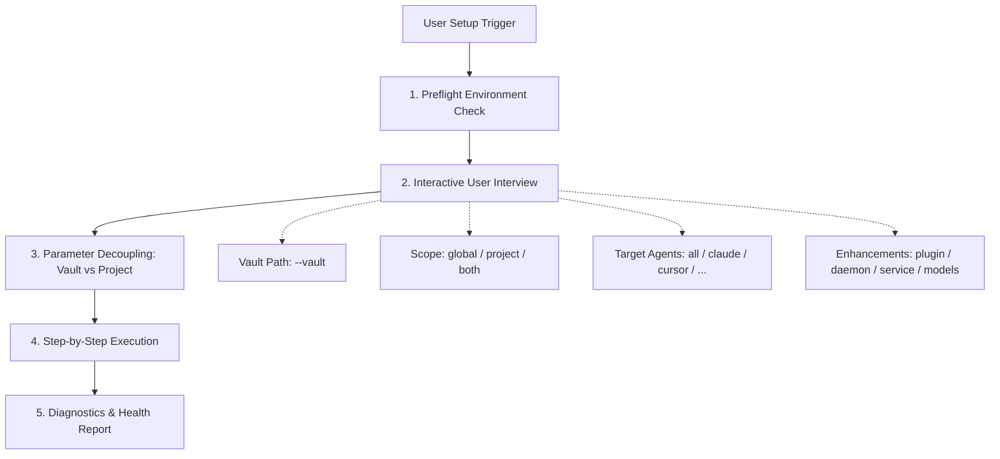

# `lernstoff-setup` Interactive Setup & Configuration Protocol

Interactive guided workflow for AI programming agents to set up, configure, and verify Lernstoff Wiki in user environments without making unilateral assumptions.

## 1. Decision Flowchart



## 2. Core Workflows

### Step 1: Preflight Environment Check

Run read-only inspection commands to detect system readiness:

1. **Check CLI installation**:
   ```bash
   lernstoff --version
   which lernstoff
   ```
2. **Check existing daemons**:
   ```bash
   lernstoff server list --json
   ```
3. **If CLI is not installed**:
   - Check Node.js version (`node -v`, requires $\ge 20.0.0$).
   - Guide the user or run global installation:
     ```bash
     npm install -g @lernstoff/cli@beta
     # or
     pnpm add -g @lernstoff/cli@beta
     ```

### Step 2: Interactive User Interview (Never Assume!)

Confirm the following 4 dimensions with the user before executing write operations:

1. **Obsidian Vault Path (`--vault`)**:
   - Ask the user for their absolute or relative Obsidian vault directory (e.g. `~/Documents/ObsidianVault`).
   - If the current working directory contains `.obsidian` or markdown notes, ask whether to use the current directory.
2. **Installation Scope (`--scope`)**:
   - **`global`**: Configures global user home files (`~/.claude.json`, `~/.gemini/...`, `~/.cursor/...`, `~/.workbuddy/...`). The MCP server and skills are available across all projects on this machine.
   - **`project`**: Configures project-level files (`.mcp.json`, `.cursor/`, `.claude/`, `.agents/`, `.codebuddy/`) in the specified code repository (`--project <path>`).
   - **`both`** _(Recommended default)_: Installs both global and project configurations for maximum convenience.
3. **Target Agents (`--target`)**:
   - Supported targets: `all`, `claude`, `cursor`, `antigravity`, `codex`, `workbuddy`.
4. **Optional Enhancements**:
   - Obsidian Community Plugin: `lernstoff plugin install`
   - Background Daemon: `lernstoff server start --daemon`
   - OS Boot Auto-Start Service: `lernstoff service install` (macOS LaunchAgent / Linux systemd)
   - Local Embedding/Reranking Models: `lernstoff doctor --pull-models`

### Step 3: Decoupled Execution Plan

> [!IMPORTANT]
> Always decouple the **Obsidian Vault directory** (`--vault <vaultPath>`) from the **Code Project directory** (`--project <projectPath>`).
> The MCP server `--vault` argument must ALWAYS point to the Obsidian Vault where notes reside, while project configuration files (`.mcp.json`, `.agents/`, etc.) must be placed in the code project workspace.

Execute in the following order:

1. **Initialize Vault** (safe and non-destructive; preserves existing notes):
   ```bash
   lernstoff init --vault <vaultPath>
   ```
2. **Install Agent Skills & MCP Server**:
   - If scope is `both`:
     ```bash
     lernstoff skill install --vault <vaultPath> --project <projectPath> --scope both --target <target>
     ```
   - If scope is `global`:
     ```bash
     lernstoff skill install --vault <vaultPath> --scope global --target <target>
     ```
   - If scope is `project`:
     ```bash
     lernstoff skill install --vault <vaultPath> --project <projectPath> --scope project --target <target>
     ```
3. **Install Memory & Cognitive Rules**:
   - If project rules desired:
     ```bash
     lernstoff rule install --project <projectPath> --target <target>
     ```
   - If global rules desired:
     ```bash
     lernstoff rule install --global --target <target>
     ```
4. **Install Obsidian Plugin** (if requested):
   ```bash
   lernstoff plugin install --vault <vaultPath>
   ```
5. **Start Background Service & Auto-Start** (if requested):
   ```bash
   lernstoff server start --vault <vaultPath> --daemon
   lernstoff service install --vault <vaultPath>
   ```
6. **Pull Local Models** (if requested):
   ```bash
   lernstoff doctor --vault <vaultPath> --pull-models
   ```

### Step 4: Verification & Diagnostics

1. **Run Doctor Diagnostics**:
   ```bash
   lernstoff doctor --vault <vaultPath>
   ```
2. **Verify Daemon Status**:
   ```bash
   lernstoff server status --vault <vaultPath>
   ```
3. **Report to User**:
   - Display a summary of all written paths (MCP config files, skill directories, rules).
   - Remind the user of any manual steps needed:
     - Restart IDE / agent clients (Claude Code, Cursor, Antigravity) to reload MCP servers.
     - In Obsidian, verify **Community Plugins** $\to$ **Lernstoff Wiki** is enabled.

## 3. Non-Negotiable Guardrails

- **Zero Blind Guessing**: Never default or hardcode a vault path without confirming with the user.
- **Strict Path Decoupling**: Never pass the code repository path to `--vault` unless the repository is itself an Obsidian vault.
- **Idempotent Execution**: All commands (`init`, `skill install`, `rule install`, `plugin install`) are safe to re-run.
