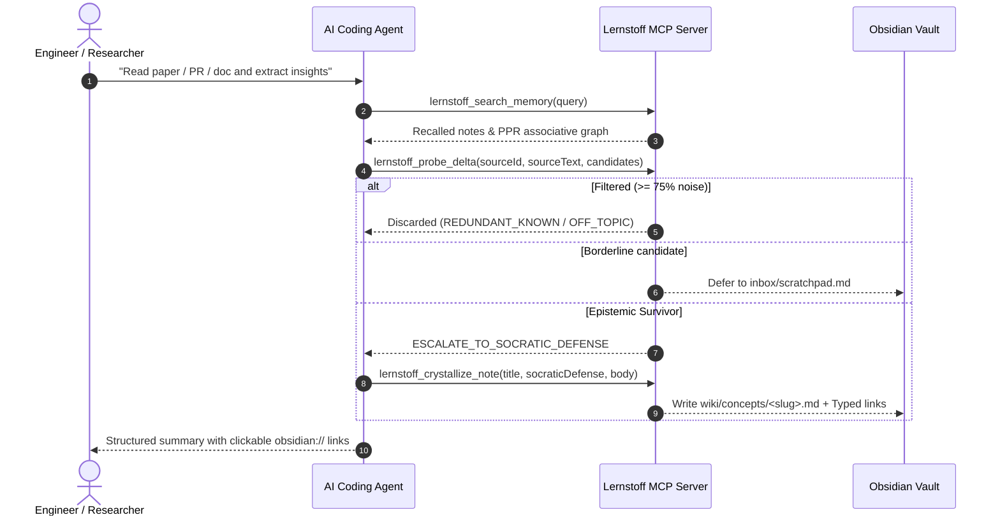

# `lernstoff-wiki` MCP Tool Manual & Protocol Guide

`lernstoff-wiki` provides a headless cognitive selective note-taking engine for AI programming agents (Claude Code, Cursor, Antigravity, OpenCode) and Obsidian. It implements a 3-stage hippocampal filtering gate, Socratic proposition defense, curiosity inquiry tracking, and Monte Carlo Personalized PageRank associative search.

---

## 1. Unified MCP Capabilities (8 Tools + 1 Resource)

`lernstoff-wiki` registers 8 native MCP tools and 1 dynamic resource template under the `lernstoff` MCP server namespace.

### Tool Matrix

| Tool Name                          | Core Purpose                      | Typical Latency      | Key Output / Side Effect                                                        |
| :--------------------------------- | :-------------------------------- | :------------------- | :------------------------------------------------------------------------------ |
| `lernstoff_probe_delta`            | 3-stage hippocampal novelty gate  | 1ms (G1) ~ 20ms (G3) | Discards noise ($\ge 75\%$), defers to scratchpad, or escalates survivors       |
| `lernstoff_crystallize_note`       | Atomic proposition note synthesis | < 15ms               | Creates/amends `wiki/concepts/<slug>.md` with Socratic frontmatter              |
| `lernstoff_manage_inquiries`       | Curiosity tree lifecycle          | < 5ms                | Manages `wiki/inquiries.md` (`list`, `add`, `close`, `reopen`)                  |
| `lernstoff_consolidate_scratchpad` | Scratchpad promotion & GC         | < 10ms               | Scans multi-source collisions ($\ge 2$) & prunes expired entries (> 14d)        |
| `lernstoff_lint_wiki`              | Socratic vault health audit       | < 25ms               | Detects orphan notes (in-degree 0), latent contradictions, synthesis candidates |
| `lernstoff_search_memory`          | Hybrid search + PPR walk          | 15ms ~ 40ms          | Vector + BM25 hits + 2-hop Monte Carlo associative graph neighborhood           |
| `lernstoff_get_note`               | Exact line slicing & backlinks    | < 5ms                | Returns note content with line numbers (`path:from:count`) & inbound backlinks  |
| `lernstoff_status`                 | Health & metrics snapshot         | < 5ms                | Reports QMD store status, active inquiries count, scratchpad metrics            |
| `lernstoff://{+path}` _(Resource)_ | Direct note content URI           | < 2ms                | Streams raw note Markdown directly into agent context                           |

---

### Detailed Tool Specifications

#### 1. `lernstoff_probe_delta`

Evaluates candidate proposition claims through the 3-stage hippocampal filter before writing to disk.

- **Parameters**:
  - `sourceId` _(string, required)_: Source identifier (e.g. `paper:arxiv-2401.05432`, `file:src/auth.ts`, `url:...`).
  - `sourceText` _(string, required)_: Original paragraph/excerpt for Gate 1 syntax verification.
  - `language` _(string, optional)_: Language code (`"zh"`, `"en"`, `"auto"`).
  - `candidates` _(array, required)_:
    - `entityName` _(string)_: Core anchor entity or concept.
    - `claim` _(string)_: Falsifiable proposition statement (never a bare noun).
    - `evidence` _(string, optional)_: Direct supporting quote.
    - `coverage` _(enum)_: `"substantially covered"` | `"briefly mentioned"` | `"named only"`.
- **Verdict Semantics**:
  - `AUTO_DISCARD`: Discarded silently (off-topic or redundant known premise).
  - `DEFER_TO_SCRATCHPAD`: Recorded into `inbox/scratchpad.md` (anti-stub rule for prose mentions with named coverage or aside mentions).
  - `PASS_TO_GATE_2` / `ESCALATE_TO_SOCRATIC_DEFENSE`: Passes to Socratic crystallization.

#### 2. `lernstoff_crystallize_note`

Synthesizes a permanent proposition note in `wiki/concepts/<slug>.md`. Enforces Socratic defense constraints.

- **Parameters**:
  - `operation` _(enum, required)_: `"CREATE_PROPOSITION"` | `"AMEND_EXISTING"` | `"SYNTHESIZE_CLUSTER"`.
  - `propositionTitle` _(string, required)_: Falsifiable claim title (e.g., `PostgreSQL MVCC Eliminates Read Locks Under Snapshot Isolation`, rejected if bare noun like `PostgreSQL`).
  - `targetPath` _(string, optional)_: Relative path when amending an existing note.
  - `inquiryRefs` _(array of strings, optional)_: Target inquiry IDs (e.g. `["#q-01", "#q-core"]`).
  - `socraticDefense` _(object, required)_:
    - `deltaExplanation` _(string)_: Q1: What irreplaceable new knowledge is added compared to existing notes?
    - `beliefUpdate` _(string)_: Q2: Which prior assumption/belief is revised or qualified?
    - `outboundLinks` _(array of objects, required)_: Q3: $\ge 2$ typed links (unless vault has $< 2$ notes total).
      - `targetNote` _(string)_: Target note slug or title.
      - `relation` _(enum)_: `"supports"` | `"contradicts"` | `"extends"` | `"qualifies"`.
  - `markdownBody` _(string, required)_: Atomic note body in standard Markdown.
  - `sources` _(array of strings, optional)_: Source references.

#### 3. `lernstoff_manage_inquiries`

Interacts with the curiosity question tree stored in `wiki/inquiries.md`.

- **Parameters**:
  - `action` _(enum, required)_: `"list"` | `"add"` | `"close"` | `"reopen"`.
  - `id` _(string, optional)_: Inquiry ID (e.g. `"#q-01"`).
  - `question` _(string, optional)_: Question statement when adding.
  - `context` _(string, optional)_: Background motivation.
  - `resolutionNote` _(string, optional)_: Note slug resolving this inquiry when closing.

#### 4. `lernstoff_consolidate_scratchpad`

Scans and manages the fast scratchpad buffer (`inbox/scratchpad.md`).

- **Parameters**:
  - `action` _(enum, required)_:
    - `"inspect"`: Returns candidates with $\ge 2$ multi-source collisions ready for promotion.
    - `"promote"`: Marks specific items as promoted so they are not re-inspected.
    - `"gc"`: Prunes entries older than 14 days without promotion to `.lernstoff/archive/decayed.jsonl`.
  - `itemIds` _(array of strings, optional)_: Item claim text or IDs to promote.

#### 5. `lernstoff_lint_wiki`

Performs an automated epistemic health check of the Obsidian Vault.

- **Parameters**:
  - `checkOrphans` _(boolean, default true)_: Flags notes with in-degree 0 (no inbound links).
  - `checkContradictions` _(boolean, default true)_: Finds unresolved contradiction pairs (`contradicts` relation).
  - `checkSynthesisReady` _(boolean, default true)_: Identifies inquiries with $\ge 5$ supporting notes ready for higher-order synthesis.

#### 6. `lernstoff_search_memory`

Queries vault memory with hybrid vector/keyword search combined with Monte Carlo Personalized PageRank.

- **Parameters**:
  - `query` _(string, optional)_: Quick query string.
  - `searches` _(array of objects, optional)_: Multi-query hybrid search:
    - `type`: `"lex"` (BM25 keyword) | `"vec"` (dense vector embedding) | `"hyde"` (hypothetical document).
    - `query`: Search text.
  - `limit` _(number, default 5)_: Maximum direct hits.
  - `includePpr` _(boolean, default true)_: Run 2-hop Monte Carlo PPR walk to surface associatively related notes.

#### 7. `lernstoff_get_note`

Reads note content with line slicing and extracts backlinks without loading full files into token context.

- **Parameters**:
  - `path` _(string, required)_: Note path (`wiki/concepts/note.md`), line slice (`wiki/concepts/note.md:1:30`), or `#docid`.
  - `includeBacklinks` _(boolean, default true)_: Returns list of inbound referencing notes.

#### 8. `lernstoff_status`

Reports real-time system metrics (QMD database health, open inquiries, scratchpad buffer size, concept count).

---

## 2. Recommended Usage Workflows

### Scenario A: Researching a Topic or Reading Documentation

1. **Recall Prior Knowledge**:
   Before reading new material, query existing vault knowledge using `lernstoff_search_memory` to ground context.
2. **Probe Epistemic Delta**:
   Extract candidate claims and submit via `lernstoff_probe_delta`.
   - Never write notes directly to disk without probing delta.
   - Let Gate 1 and Gate 2 discard ~75% of generic descriptions and introductory text.
3. **Formulate Socratic Defense**:
   For escalating candidates, formulate explicit answers:
   - What belief was updated?
   - Connect $\ge 2$ typed links (`supports`, `contradicts`, `extends`, `qualifies`).
   - Title MUST be a proposition (e.g. `Raft Leases Prevent Split-Brain Reads`), never a noun (`Raft`).
4. **Crystallize**:
   Invoke `lernstoff_crystallize_note`.

### Scenario B: Checking Vault Health & Synthesizing Clusters

1. Call `lernstoff_lint_wiki` to inspect orphan notes, contradiction edges, and inquiries ready for synthesis.
2. If an inquiry has $\ge 5$ supporting notes:
   - Read the notes using `lernstoff_get_note`.
   - Synthesize a higher-order proposition note using `lernstoff_crystallize_note(operation: "SYNTHESIZE_CLUSTER")`.
   - Close the resolved inquiry using `lernstoff_manage_inquiries(action: "close", id: "#q-xx")`.

### Scenario C: Scratchpad Consolidation & Garbage Collection

1. Invoke `lernstoff_consolidate_scratchpad(action: "inspect")`.
2. Entries with $\ge 2$ collisions across $\ge 2$ independent sources indicate emergent concepts. Promote them into full proposition notes.
3. Run `lernstoff_consolidate_scratchpad(action: "gc")` to prune stale items (> 14 days).

---

## 3. Recommended Rules & Anti-Patterns

### ✅ Best Practices

- **Proposition-as-Title**: Every note title must express a complete claim with subject, verb, and object (e.g. `LSM-Trees Trade Read Amplification for Sequential Write Throughput`).
- **Anti-Orphan Requirement**: Every proposition note must link to at least 2 existing concept notes with typed predicates (`supports`, `contradicts`, `extends`, `qualifies`).
- **Use Scratchpad as Safety Valve**: If unsure whether an insight warrants a permanent note, let `lernstoff_probe_delta` defer it to `inbox/scratchpad.md`.

### ❌ Anti-Patterns to Avoid

- **Never create noun-topic notes**: Titles like `Docker.md`, `Kubernetes.md`, or `Rust Error Handling.md` are prohibited.
- **Never bypass `lernstoff_probe_delta`**: Direct file system writes bypass hippocampal filtering and introduce cognitive bloat.
- **Never hoard information**: If a claim is already well-known or redundant ($S_{\text{sem}} \ge 0.85$ and low lexical delta), let the gate discard it.
