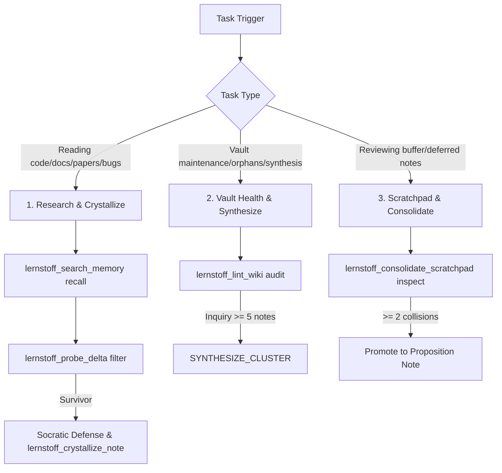

# `lernstoff-wiki` Cognitive Protocol

Headless cognitive note-taking engine implementing a 3-stage hippocampal novelty gate, Socratic proposition defense, curiosity inquiry tracking, and Monte Carlo Personalized PageRank memory search.

## 1. Decision Tree & Core Workflows

Choose the matching workflow based on your current task:

### Workflow 1: Research & Crystallize

1. **Recall Prior Knowledge**: Query memory before exploring new territory using `lernstoff_search_memory`.
2. **Probe Epistemic Delta**: Submit candidate claims to `lernstoff_probe_delta`. Discard ~75% noise; defer borderline items to scratchpad.
3. **Socratic Defense**: For escalated survivors, answer Q1 (epistemic delta), Q2 (belief revision), and connect $\ge 2$ typed links (`supports`, `contradicts`, `extends`, `qualifies`).
4. **Crystallize**: Call `lernstoff_crystallize_note(operation: "CREATE_PROPOSITION")`.

### Workflow 2: Vault Health & Synthesize

1. Run `lernstoff_lint_wiki` to spot orphan notes, contradictions, and synthesis-ready inquiries ($\ge 5$ notes).
2. Read supporting notes via `lernstoff_get_note` and synthesize a higher-order principle with `operation: "SYNTHESIZE_CLUSTER"`.
3. Resolve the inquiry via `lernstoff_manage_inquiries(action: "close")`.

### Workflow 3: Scratchpad & Consolidate

1. Run `lernstoff_consolidate_scratchpad(action: "inspect")` to detect multi-source collisions ($\ge 2$).
2. Promote confirmed insights into full proposition notes; prune expired items (> 14d) with `action: "gc"`.

## 2. Non-Negotiable Guardrails

- **Proposition-as-Title Rule**: Titles MUST express a complete falsifiable claim (e.g., `PostgreSQL MVCC Eliminates Read Locks Under Snapshot Isolation`), NEVER bare nouns or topics (e.g., `PostgreSQL`, `MVCC`).
- **Anti-Orphan Requirement**: Every permanent note MUST connect $\ge 2$ typed links (`supports`, `contradicts`, `extends`, `qualifies`) to existing notes.
- **Hippocampal Gate First**: NEVER write directly to `wiki/` or `inbox/scratchpad.md` without running `lernstoff_probe_delta`.

## 3. Progressive References

- Detailed MCP tool schemas, parameters, and error cases: [mcp-tools.md](references/mcp-tools.md)
- Concrete good/bad titles, Socratic proofs, and synthesis patterns: [best-practices.md](references/best-practices.md)
