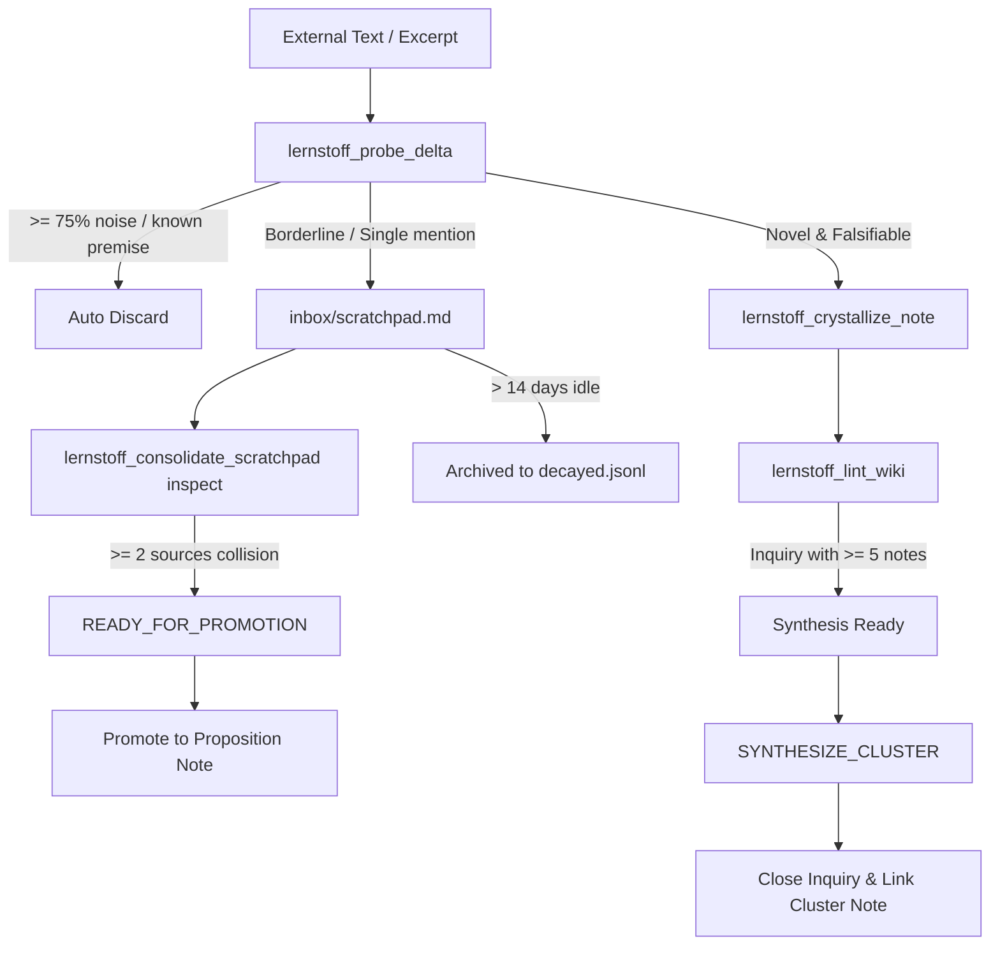

# Lernstoff Best Practices & Socratic Defense Protocol

This guide establishes the cognitive hygiene standards for evergreen note crystallization, proposition design, and knowledge evolution within Obsidian.

---

## 1. Proposition-as-Title Standard

Every note title in `wiki/concepts/` must be a falsifiable proposition claim (Subject + Predicate + Object/Condition). Never name notes after bare topics, tools, or nouns.

### Good vs. Bad Title Examples

| Anti-Pattern (Bare Nouns / Topics) | Recommended Proposition Title                                                     | Why It Matters                                                                 |
| :--------------------------------- | :-------------------------------------------------------------------------------- | :----------------------------------------------------------------------------- |
| ❌ `PostgreSQL MVCC`               | ✅ `PostgreSQL MVCC Eliminates Read Locks Under Snapshot Isolation`               | Declares the exact operational invariant and trade-off.                        |
| ❌ `Raft Consensus`                | ✅ `Raft Leader Leases Prevent Split-Brain Reads Without Quorum Rounds`           | Identifies the mechanism and the failure mode it addresses.                    |
| ❌ `Rust Error Handling`           | ✅ `Rust Result Type Replaces Runtime Exceptions With Explicit Control Flow`      | Falsifiable design choice comparing two architectures.                         |
| ❌ `Redis Persistence`             | ✅ `Redis Append-Only File Fsync Trades Write Latency for Durability Bounds`      | Clarifies the engineering compromise instead of generic product documentation. |
| ❌ `React Server Components`       | ✅ `React Server Components Eliminate Client Bundle Overhead for Static Subtrees` | Explains what changes in runtime performance and why.                          |

---

## 2. Socratic Defense Protocol (Q1, Q2, Q3)

When `lernstoff_probe_delta` escalates a surviving claim, the agent must formulate a rigorous Socratic defense before calling `lernstoff_crystallize_note`.

### Defense Template & Concrete Example

Suppose we are crystallizing an insight about database concurrency:

#### Q1: Irreplaceable Knowledge Delta

- **Question**: What exact epistemic delta does this note add compared to existing vault notes?
- **Bad answer**: "It explains MVCC." (Vague, non-specific).
- **Good answer**: "While existing note `[[two-phase-locking-bottlenecks]]` documents writer-blocking-reader contention, this note details how PostgreSQL assigns transaction snapshot IDs (`xmin`/`xmax`) to table tuples to guarantee consistent read views without acquiring shared read locks."

#### Q2: Belief Revision & Qualification

- **Question**: Which prior assumption, mental model, or rule is revised, challenged, or qualified?
- **Bad answer**: "None, this is just good info." (Fails cognitive filtering).
- **Good answer**: "Revises the common assumption that all ACID isolation levels require lock acquisition on reads; snapshot isolation achieves non-blocking reads at the cost of write skew vulnerabilities and vacuum overhead."

#### Q3: Typed Link Relations ($\ge 2$)

- **Question**: How does this note connect to existing concept notes in the vault graph?
- **Typed Predicates**:
  - `supports`: Strengthens or provides empirical evidence for an existing claim.
  - `contradicts`: Exposes tension, trade-offs, or opposing results.
  - `extends`: Broadens a mechanism into a new domain or architecture.
  - `qualifies`: Restricts an existing claim to specific operational bounds.
- **Example Outbound Links**:
  ```json
  [
    {
      "targetNote": "two-phase-locking-bottlenecks",
      "relation": "contradicts"
    },
    {
      "targetNote": "vacuum-overhead-in-append-only-storage",
      "relation": "supports"
    }
  ]
  ```

---

## 3. Scratchpad Promotion & Cluster Synthesis Flow



### Scratchpad Promotion Criteria

1. **Multi-Source Collision**: A claim or entity is deferred to `inbox/scratchpad.md`. If a second independent source (different paper, PR, or architecture doc) hits the same entity/claim, `hitCount >= 2`.
2. **Promote Action**:
   - Run `lernstoff_consolidate_scratchpad(action: "inspect")` to detect items with `READY_FOR_PROMOTION`.
   - Crystallize the item as a full proposition note with Socratic defense.
   - Run `lernstoff_consolidate_scratchpad(action: "promote", itemIds: [...])` to mark the buffer entry as resolved.

### Cluster Synthesis (`SYNTHESIZE_CLUSTER`)

1. Inquiries in `wiki/inquiries.md` track open architectural unknowns.
2. When `lernstoff_lint_wiki` reports an inquiry has $\ge 5$ supporting proposition notes, the inquiry is flagged as `synthesisReady`.
3. Read the supporting notes via `lernstoff_get_note`.
4. Call `lernstoff_crystallize_note` with `operation: "SYNTHESIZE_CLUSTER"`, uniting the discrete findings into a higher-order principle.
5. Close the inquiry via `lernstoff_manage_inquiries(action: "close", id: "#q-xx", resolutionNote: "<cluster-slug>")`.
